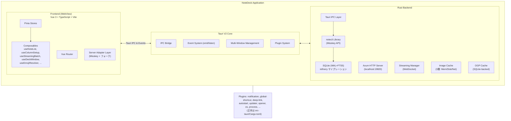
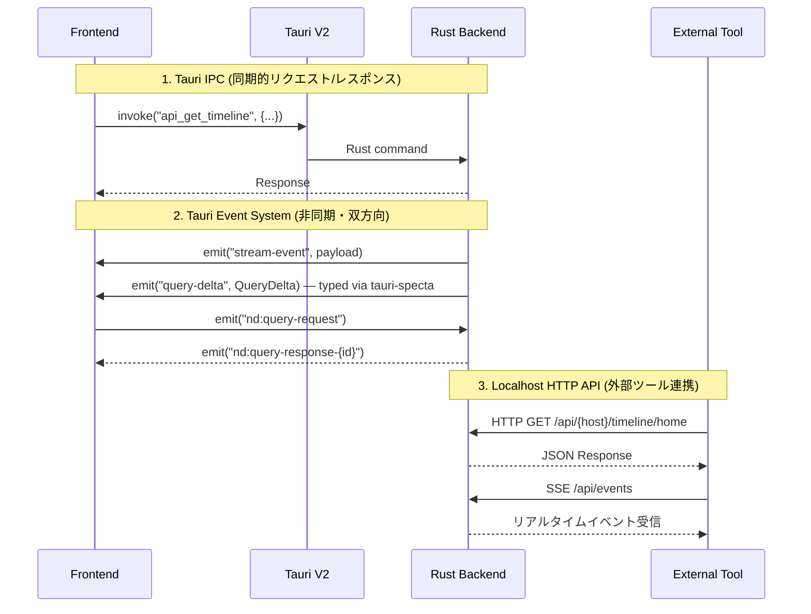
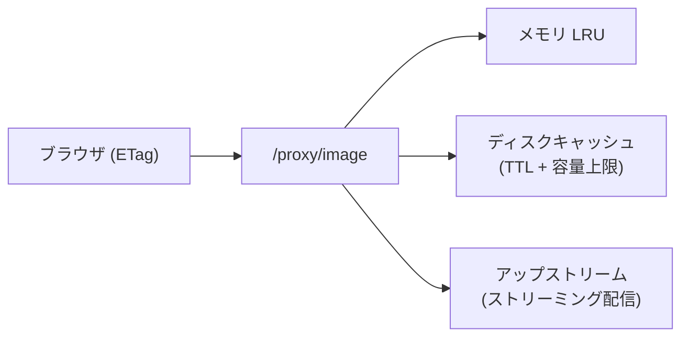
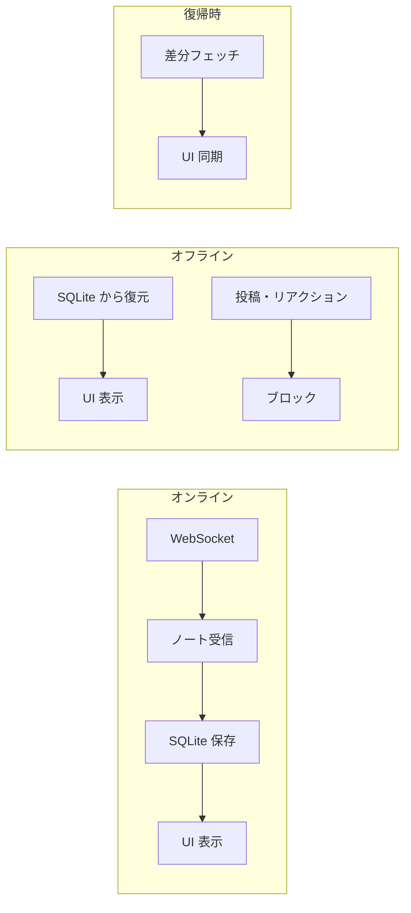
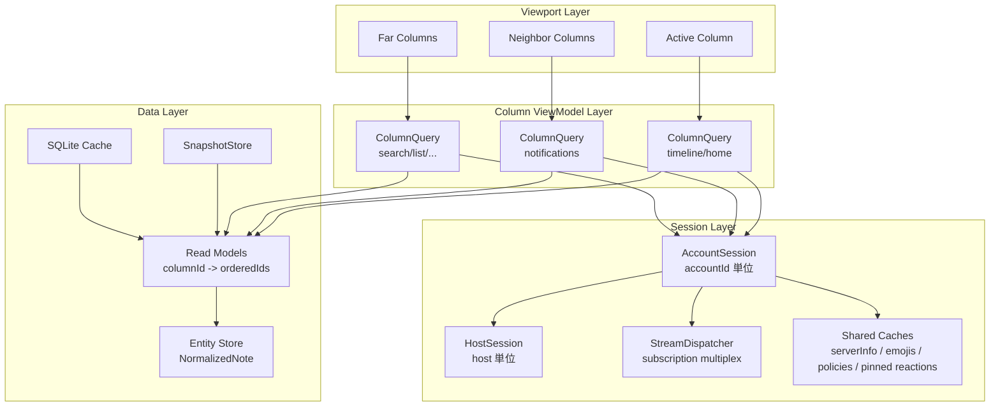
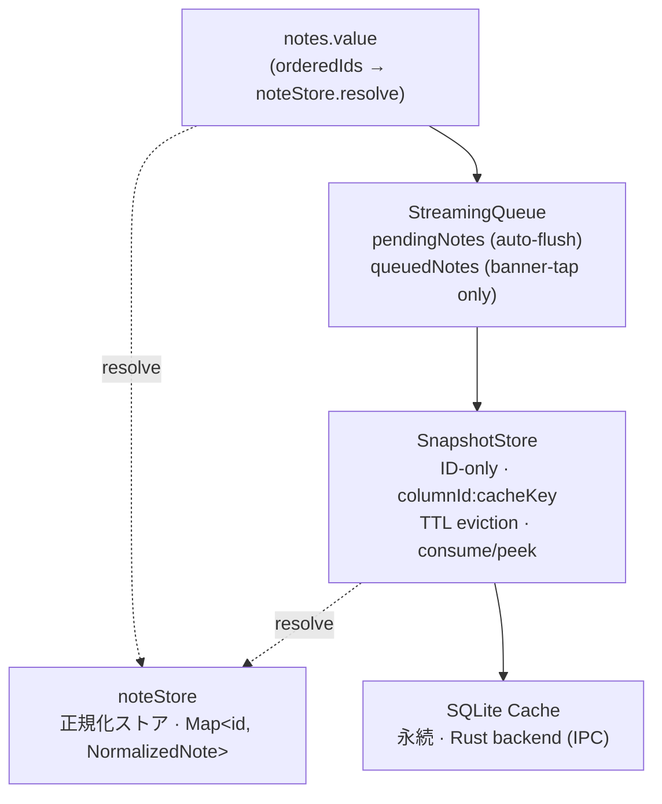
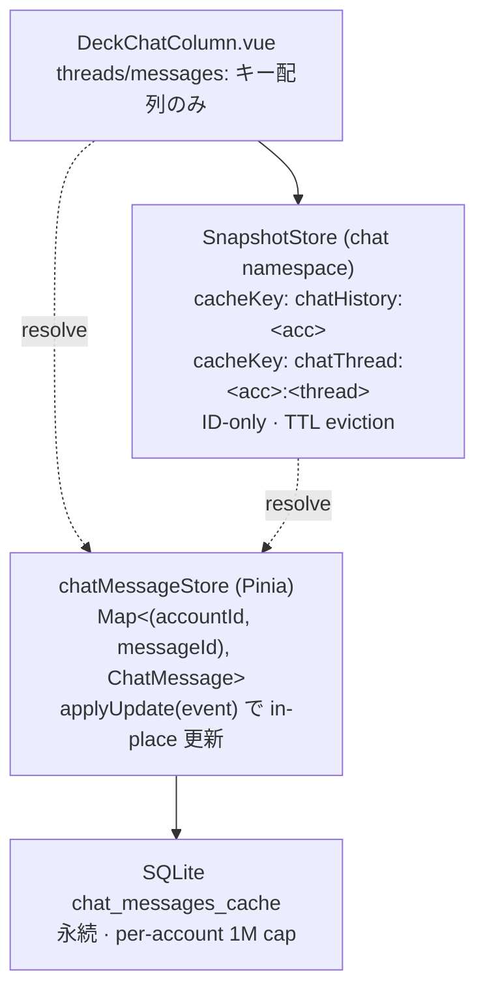
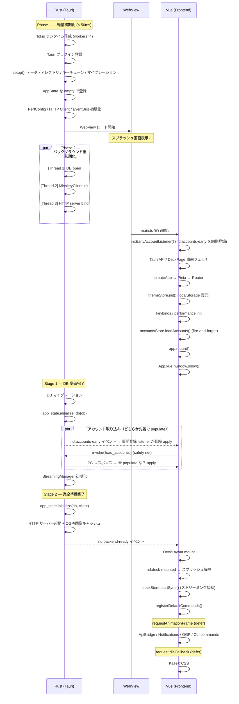
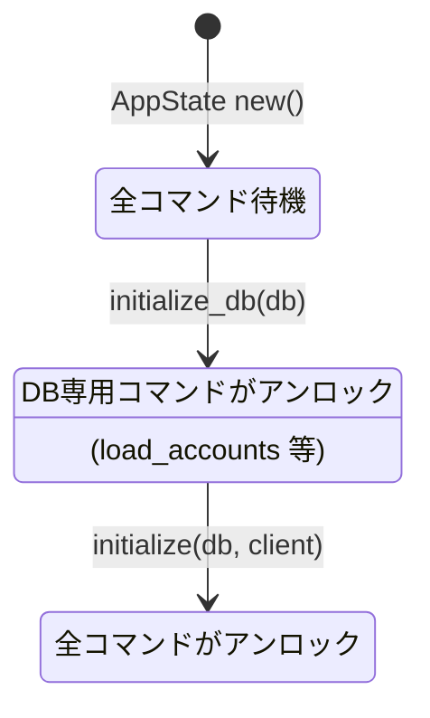

# ARCHITECTURE

NoteDeck — マルチサーバー対応 Misskey デッキクライアントのアーキテクチャ。

---

## 目次

- [縦の経路: 1 つのノートが画面に出るまで](#縦の経路-1-つのノートが画面に出るまで)
- [アーキテクチャ概要](#アーキテクチャ概要)
  - [全体像](#全体像)
  - [notedeck（GUI アプリ）](#notedeckgui-アプリ)
  - [notecli（コアライブラリ）](#notecliコアライブラリ)
- [Session-centric + Viewport-centric Architecture](#session-centric--viewport-centric-architecture)
- [Rust Query Runtime + Read Model](#rust-query-runtime--read-model)
- [ノートキャッシュ・キューアーキテクチャ](#ノートキャッシュキューアーキテクチャ)
- [チャットキャッシュ・アーキテクチャ](#チャットキャッシュアーキテクチャ)
- [レンダリングパフォーマンス](#レンダリングパフォーマンス)
- [Cargo workspace の構成](#cargo-workspace-の構成)
  - [目指す構成の詳細: 置き場の規則と経緯](#目指す構成の詳細-置き場の規則と経緯-1106)
- [Boot Sequence](#boot-sequence)
- [OS の状態への自動適応](#os-の状態への自動適応-931--935--928--986--461)
- [採用状況マトリクス](#採用状況マトリクス)

---

## 縦の経路: 1 つのノートが画面に出るまで

このドキュメントの他の節は、層ごとの説明（横方向）で書かれている。全体像を知るには向くが、新しく入った人が最初に詰まるのは全体像ではなく**入口**——「で、実際に何がどう繋がっているのか」。

そこでここでは、**フォローしている誰かがノートを投稿してから、それが自分のタイムラインカラムに現れるまで**を、1 本の線として端から端まで追う。各段の詳しい仕様は後続の節にある。

| # | 場所 | 何が起きるか |
|---|------|-------------|
| 1 | notecli（Rust） | Misskey サーバーとの WebSocket からイベントを受け取る |
| 2 | `streaming.rs` の `TauriEmitter` | 受信を OS 通知 / WebView / SSE / Query Runtime の 4 つの出力先へ同時に配る |
| 3 | `query_runtime.rs` の `ingest_stream_event` | Read Model に反映し、フラッシュ待ちに積む |
| 4 | `query_runtime.rs` の `drain_pending`（`lib.rs` の flusher が駆動） | 溜まった分を 1 フレームぶんまとめ、`query-delta` を typed event として emit |
| 5 | `core/queryDeltaBus.ts` | `query-delta` をアプリ全体で 1 本だけ listen し、登録済みの購読へ配る |
| 6 | `adapters/misskey/query.ts` の `createQuerySubscription` | 自分の `queryId` 宛だけを拾い、insert / delete / update に振り分ける |
| 7 | `components/deck/Deck*Column.vue` | `streaming.subscribe` の `onInsert` でノートに変換して enqueue する |
| 8 | `composables/useNoteColumn.ts` の `enqueueWithQuery` | 組込フィルタとカラムクエリを通す。通らなければ**ここで消える** |
| 9 | `composables/useStreamingBatch.ts` の `enqueueNote` | rAF でまとめ、スクロール位置に応じて即挿入かバナー待ちかを決める |
| 10 | noteStore + 仮想リスト | 実体は noteStore に 1 つだけ置き、カラムは ID 配列を持って描画する |

### なぜこの形なのか

線を追うだけでは「なぜ途中にこれがあるのか」が分からないので、各段の存在理由を挙げる。ここが変わらない限り、この経路も変わらない。

- **2 で分岐する** — 同じ 1 つの受信を、通知・画面・外部 API・Read Model が別々に取りに行くと、購読が増えるほど WebSocket 側の負荷と取りこぼしのリスクが増える。受け口は 1 つにして、そこから配る
- **4 でまとめる** — ストリーミングイベントは 1 件ずつ来るが、1 件ごとに IPC を渡すと流速の速いカラムで WebView 側が溢れる。フレーム単位に畳んで IPC 回数を落とす
- **5 で 1 本だけ listen する** — 購読ごとに listen すると、スリープ復帰やウィンドウ再生成のときに何を再登録すべきかを追えなくなる。listen は 1 本に固定し、配布は JS 側で行う
- **8 でフィルタする** — 取得（何が届くか）と表示（何を見せるか）を同じ場所で決めると、フィルタを足すたびに取得側を触ることになる。届いたものを落とす判断はここに閉じる
- **10 で ID だけ持つ** — 同じノートが複数のカラムに出るとき実体を複製すると、リアクションが付いたときに全カラムを更新して回る必要がある。実体を 1 つにすれば更新は 1 回で済む

### 逆から辿るとき

画面に出ているノートが「なぜこう表示されているのか」を調べるときは、この表を下から上に読む。よくある分岐は次の 2 つ。

- **届いているのに出ない** → 8 のフィルタか、9 のバナー待ち（スクロール位置）で止まっている
- **そもそも届かない** → 2 より前。WebSocket の購読状態を見る。Stream Inspector カラムが raw イベントをそのまま表示するので、Rust 側まで来ているかはそこで判別できる

フロントの `commands.xxx()` から Rust 実装へ飛ぶ方法は [DEVELOPMENT.md — IPC 境界を跨ぐジャンプ](DEVELOPMENT.md#ipc-境界を跨ぐジャンプ) を参照。

---

## アーキテクチャ概要

### 全体像



**技術スタック:**
- **フレームワーク**: Tauri V2
- **フロントエンド**: Vue 3 + TypeScript + Vite（Vapor モード移行予定 [#52](https://github.com/notedeck-dev/notedeck/issues/52)）
- **バックエンド**: Rust (Axum, notecli)
- **対応プラットフォーム**: Windows, macOS, Linux, Android

**Frontend ↔ Backend の3つの通信パターン:**



---

### 目指す構成: notecore と notemaid（[#1106](https://github.com/notedeck-dev/notedeck/issues/1106)）

上の全体像のうち Tauri 非依存のドメインは **notecore** クレートに切り出し済み。AI が所有するもの (エージェントループ / HEARTBEAT / capability の実行 / セッション / skill / メモ / AI 設定) は **notemaid** (lib + bin の 1 クレート) に置く (2026-09-29 に切り出し済み)。notemaid は常に別プロセスで、アプリが sidecar として子プロセス起動する (既定、設定ゼロ) / ログイン時のユーザータスクで常駐 (任意) の 2 通りを同じプロトコルで受ける。iOS / Android と sidecar が無い開発時だけ in-process の transport。常駐の対象は notemaid だけで、データ面は常に手元で動く。別の端末や自分のサーバーで動く notemaid に繋ぐ構成 (リモート) は採用しない (2026-09-29、理由は ROADMAP と #1106)。「notecore 全体を notecored として自分のサーバーで常駐させる」旧計画は #1106 で中止した (理由は同 issue の 2026-09-29 コメント)。

```
フロントエンド (Vue)                WebView は常に手元の Rust とだけ話す
      │ IPC
┌─ アプリ (Tauri、手元) ────────┐   AI 系コマンド    ┌─ notemaid (常に別プロセス) ───────────────────┐
│ OS 統合 + クライアント層     │ ───────────────▶ │ メイド (ループ / HEARTBEAT / 配送)           │
│  notecore (データ面、常に手元)│  socket /        │  notecore (共有基盤: Vault / 認可 / 設定だけ。│
│  notecli                     │  named pipe      │            notes DB は開かない)              │
└──────────────────────────────┘                  │  notecli                                     │
                                                  └──────────────────────────────────────────────┘
誰が notemaid を起動するか: アプリが sidecar を子プロセスで (既定、設定ゼロ) / ログイン時のユーザータスク (任意、常駐)。別の端末やサーバーで動く notemaid に繋ぐ構成は採用しない (理由は ROADMAP)
iOS / Android と sidecar が無い開発時は in-process の transport (コマンド面は同じ)
```

- クレートの依存は一方向: notecli ← notecore ← notemaid ← アプリ。notemaid が notecore から借りるのは共有基盤 (Vault / 認可 / 設定 store / アカウント情報) だけで、データ面 (notes DB / ストリーミング / クエリランタイム) には依存しない。notecore は Tauri も AI も知らない。プロセスとしては並列で、両方を含むのはアプリの配布物。4 つは同じリポジトリの workspace クレート
- 切替点は手元の Rust のクライアント層 1 箇所。データ系コマンドはコマンド表を通って常に in-process の notecore へ、AI 系コマンドは notemaid の表を通って常に socket / named pipe で notemaid のプロセスへ (iOS / Android と sidecar が無い開発時は in-process transport。`src-tauri/src/client_layer.rs`)。フロントは違いを知らず、接続 / 互換の状態面だけを知る
- データ面の notecore はデバイスに 1 つ (アプリの中) だけで、notemaid は notes DB を開かない。Misskey は notecli で直接叩き、アプリが生きていれば socket でアプリ側の notecore にキャッシュを聞く。同一端末では設定ディレクトリを共有し、書くのは自分の持ち物 (セッション / メモ / skill / AI 設定) だけ。トークンは OS キーチェーンを読み、アカウント一覧は接続時にアプリから受け取る。メイドの持ち物 (セッション / メモ / skill / AI 設定) は同じ設定ディレクトリのファイルで、端末はそれを編集する
- 認証、イベント面、状態の所在は #1106 の仕様コメントが正本 (2026-09-29 のコメントで AI 面に縮めた後の読み方が優先)
- 置き場の規則 (どのドメインをどのクレートに置くか、command の種別、検査) と経緯は「[目指す構成の詳細](#目指す構成の詳細-置き場の規則と経緯-1106)」

---

### notedeck（GUI アプリ）

#### A-1. Query Bridge（Rust ↔ フロントエンド双方向クエリ）

**場所**: `query_bridge.rs` + `core/apiBridge.ts`

外部 HTTP リクエスト → Rust → Tauri Event → Vue/Pinia → Tauri Event → Rust → HTTP レスポンス。
フロントエンドのリアクティブ状態（デッキカラム、コマンド一覧等）を外部ツールから直接取得可能。

---

#### A-2. マルチウィンドウ・デッキ（クロスウィンドウ D&D）

**場所**: `useDeckWindow.ts` + `useColumnDrag.ts`

- カラムを別ウィンドウにポップアウト
- ウィンドウ間でカラムをドラッグ移動
- マルチモニター対応のレイアウト保存・復元
- ウィンドウ閉鎖時の自動カラム回収

---

#### A-2b. PiP ウィンドウ（常前面フローティングカラム）

**場所**: `src/windows/pip.ts` + `src/views/PipPage.vue`

- デッキのカラムを常前面フローティングウィンドウとして切り離し
- 375×700px（リサイズ可能）、`alwaysOnTop`、複数同時起動（動的ラベル `pip-*`）
- コマンドパレット / タイトルバー / カラムメニューの 3 経路で起動

---

#### A-3. HTTP API（notecli ルーター共有）

**場所**: `http_server.rs`（notecore）+ `http_server.rs`（notecli）

notecli の `build_core_routes()` でコア API のルートを共有し、notedeck 固有ルート（deck, commands, image proxy, OpenAPI docs）を `.merge()` で追加。SSE イベントストリーム、Scalar UI ドキュメント付き。

---

#### A-4. ストリーミング → マルチ配信ブリッジ

**場所**: `streaming.rs` + `EventBus` + `query_runtime.rs`

WebSocket 受信 → 1箇所で4つの出力先に同時配信:
1. OS ネイティブ通知（`tauri-plugin-notification`）
2. WebView イベント（`app.emit("stream-event")`。`stream-status` サブイベントが接続状態の唯一の真実源）
3. SSE（外部 HTTP クライアント向け）
4. **Query Runtime の Read Model**（後述 A-11）— stream-note/mention/notification/chat-message などを ingest し、`query-delta` を typed event として emit

ストリーミングで受信したノートは `db.cache_note()` で SQLite に非同期保存。

#### A-4b. Subscription suspend / resume

**場所**: `notecli::streaming`（`StreamingManager::suspend_subscription` / `resume_subscription`）+ `query_set_runtime_state`（Tauri コマンドとしての `stream_suspend_subscription` / `stream_resume_subscription` は JS から呼ばれなくなったため撤去済み）

WebSocket 接続は維持したまま、subscription 単位で channel から **WS unsubscribe** する。`info.active = false` にして受信ループから除外し、`WsCommand::Unsubscribe` を WS に送出。Misskey 側もそのチャンネルへの送出を停止するため、suspend 中の noteUpdated は再送されない（resume 時に過去分は届かない）。WS 自体の再接続時は active な subscription と subNote が replay され、subNote はセッション内 dedup で二重送信（Misskey 側 subNote は refcount 式で冪等でない）を防ぐ。

`live → warm → suspended` は `createQuerySubscription.setRuntimeState` → `query_set_runtime_state` が駆動する。warm → suspended への escalation（既定 8s、`WARM_GRACE`）は Rust 側 QueryRuntime の warm timer が行う。JS 側 `MisskeyStream` は接続状態の funnel（`setStatus`）と 5s の offline grace debounce のみを担う。

**suspend させる条件**（`useNoteColumn` の `[isVisible, isLive]` watcher）:

| isVisible | isLive | 挙動 |
|-----------|--------|------|
| false | * | warm → 8s 後 suspend (Rust 側 unsub) |
| true | false | **subscription は live 維持**、`streamingBatch` だけ pause |
| true | true | live、`onResume` で sinceId 差分 fetch、batch flush 再開 |

**重要**: 「可視・予算外」だけでは suspend しない。これをやると見えているのに reaction が永続的に取り逃される（Misskey は再送しない）。

**main チャンネルは suspend / unsubscribe の対象外** (#984): Misskey の `main` は `shouldShare` チャンネルで **1 WS 接続に 1 本しか張れない**（2 本目の connect はサーバーが黙って無視する）。通知・メンション・OS 通知・未読バッジ・チャットの履歴一覧の新着 (`newChatMessage`、`stream_subscribe_main` で張り専用イベント `stream-new-chat-message` で流す) がすべてこの 1 本にぶら下がるため、main の寿命はカラム（query）ではなく**アカウントセッション**に属する。`StreamingManager` は main をアカウント単位で dedup し、main への `unsubscribe` / `suspend_subscription` を no-op にする。解放経路は `disconnect` のみ。

#### A-4c. Reaction freshness guarantees

**場所**: `useNoteCapture` + `noteStore.applyUpdate`

reaction / poll vote / delete は **2 経路冗長化** で取り逃しを最小化する。

1. **Channel auto-capture**: `stream-note-updated` が timeline / antenna / channel / role / list / mentions の subscription 経由で届く。新着ノートとセットで運ばれるので一括カバーできるが、subscription が suspend されると止まる
2. **Per-note capture (`subNote` / `unsubNote`)**: 個別 noteId に対する独立した WS subscription。channel と無関係なので、channel が suspend されてもそのノートの noteUpdated は受信し続ける。WS 再接続時は capture 中の noteId が replay され、セッション内 dedup で二重送信を防ぐ

`useNoteCapture` は表示中の上位 `noteCaptureMax`（既定 80–150）件をすべて自動 subNote する。channel と capture の **両方が同じイベントを fire する** ため、`noteStore.applyUpdate` は `(noteId, type, userId, reaction, choice)` を sig としてキー化し、1.5s 窓で重複を弾く。

**カバー範囲:**

| 状態 | 新着ノート | 既存ノートの reaction |
|------|-----------|---------------------|
| channel alive | ✅ channel | ✅ channel + capture |
| channel suspended（不可視 >8s） | ❌ どちらも届かない | ✅ capture のみ |
| ノートが noteCaptureMax 超過位置にスクロール | — | ❌ capture 対象外 |

つまり **新着ノートを取り逃さない保証は無い**（channel suspend 時）。reaction の鮮度だけは復帰時に古くならない。新着ノートを死守したい場合は warm timer を伸ばすか、`onResume` で先頭ページを refetch するかの別アプローチが必要。

---

#### A-5. 3層画像プロキシキャッシュ

**場所**: `image_cache.rs` + `/proxy/image`



CSP で外部画像を直接ロードせず、Rust 側のプロキシを経由。ETag/304 対応、インフライト重複排除、同時フェッチ数の制限。容量・TTL・同時フェッチ数の既定値は `crates/notecore/src/perf_config.rs` が正本。

---

#### A-6. OGP プラグインシステム（15プラットフォーム対応）

**場所**: `ogp/plugins/` (Twitter, YouTube, Pixiv, Amazon, ニコニコ 等)

URL ごとに専用パーサーが起動し、汎用 OG タグ解析より高精度なプレビューを生成。
3段フォールバック: プラグイン → サーバー API → 直接 HTML パース。

---

#### A-7. グローバルショートカット + ボスキー + システムトレイ

**場所**: `lib.rs` + `tray.rs`（デスクトップ専用 `#[cfg(not(mobile))]`）+ `useOsGlobalShortcuts.ts`（keybinds の `os-global` スコープを `tauri-plugin-global-shortcut` に登録。Rust 側は plugin を立てるだけ）

既定のキーは `src/defaults/keybindings.json5` が正本:

- `Ctrl+Shift+B`: ボスキー（瞬時にウィンドウ非表示）
- `Ctrl+Alt+N`: クイックノート（ウィンドウ表示 + 投稿フォーム起動）
- トレイアイコン: 左クリックで表示切替、右クリックメニュー
- 閉じるボタン: トレイに隠す（終了しない）

---

#### A-8. オフラインファースト（読み取り専用）

**場所**: `useNoteColumn.ts` + `useColumnSetup.ts` + `DeckTimelineColumn.vue`



- **オフライン検出**: WebSocket 切断 (`disconnected`/`reconnecting`) + API fetch 失敗の両方で即座に検出。接続状態は Rust の `stream-status` イベントだけを信じる（JS 側の楽観的 `connected` は廃止。冪等 connect でも Rust が現在状態を emit する）
- **接続状態の台帳**: 生の遷移は `core/streamHealth` に記録し、healthcheck 診断とオフラインバッジ tooltip が「いつからこの状態か」を表示する（#698）
- **キャッシュ自動切替**: API 失敗時にキャッシュ済みノートを表示し続ける。スクロールで古いノートも SQLite から読み込み
- **書き込みガード**: オフライン時はリアクション・リノート・リプライ・引用・削除・編集・ブックマークをサイレントにブロック
- **自動復帰**: WebSocket 再接続成功 or API fetch 成功で `isOffline` が自動解除
- **Android 復帰**: `MainActivity.onResume` → `nd-app-resumed` DOM イベント → `useDeckInit` が `emitDeckResume`（reconnect / observer 張り直し / `reattachQueryDeltaListener` / refetch）を冪等に駆動
- **UI バナー**: 「オフライン — キャッシュを表示中」をカラム上部に表示

**方針**: 書き込みキューイングは行わない。Misskey はリアルタイム性が重要な SNS であり、オフライン時に蓄積した操作を後から送信しても文脈が失われる。

---

#### A-9. フロントエンド層

**Pinia Stores**（正本: `src/stores/`。下表は主要なもの）:

| Store | 役割 |
|-------|------|
| `accounts` | マルチアカウント管理（ゲスト・ログアウト済みアカウント含む） |
| `deck` | デッキ・カラム・レイアウト・プロファイル管理（カラム種別は `BuiltinColumnType` が正本） |
| `streaming` | WebSocket接続状態・購読管理 |
| `notes` | ノートのキャッシュ・正規化 |
| `emojis` | カスタム絵文字管理 |
| `servers` | 接続先サーバー情報 |
| `theme` | テーマ設定 |
| `ui` | UI状態 |
| `keybinds` | キーバインド設定 |
| `windows` | マルチウィンドウ管理 |
| `plugins` | AiScriptプラグイン |
| `pinnedReactions` | ピン留めリアクション |
| `recentEmojis` | 最近使った絵文字 |
| `confirm` | 確認ダイアログ管理 |
| `deckProfile` | デッキプロファイル管理 |
| `deckWallpaper` | デッキ壁紙設定 |
| `performance` | パフォーマンス設定 |
| `themeFileSync` | テーマファイル同期 |
| `toast` | アプリの通知。警告・エラー・アクション付きは右下の通知カード + 受信トレイ (ボトムバーのベル)、軽い成功・情報はボトムバーのステータス表示 (表示場所の無い画面ではカード) |
| `offlineMode` | オフラインモード状態管理 |
| `realtimeMode` | リアルタイムモード状態管理 |

**Server Adapter パターン** (`types.ts` → `registry.ts` → `misskey/`):
Misskey 本家および Misskey を名乗り続けるフォークに共通インターフェースで対応。

---

#### A-10. タイムライン DOM 管理

**場所**: `NoteScroller.vue` + `useNoteList.ts` + `useStreamingBatch.ts`

`@tanstack/vue-virtual` による仮想スクロールで、viewport + overscan 分のみ DOM に描画する。

**仮想スクロール:**

| 設定 | 値 | 説明 |
|------|-----|------|
| `noteListMax` | 200（デフォルト） | データ配列の上限（`performanceStore` で設定可能、50〜1000） |
| `overscan` | 8 | viewport 外に余分に描画する件数 |
| `estimateSize` | 動的 | 実測値の指数移動平均（ResizeObserver のループを避けるため次フレームで反映） |

- `NoteScroller.vue` が `useVirtualizer` で仮想化。実 DOM は 30-50 件程度に抑制
- `measureElement` + ResizeObserver で可変高さ（テキストのみ 80px〜画像付き 400px+）を自動追跡

**現行の制約と次の一手:**

- 現行は `orderedIds` を column ごとに持ち、描画時に `notes.resolve(ids)` で `NormalizedNote[]` を再構築する
- `notes` store は `triggerRef(noteMap)` ベースのため、局所更新でも列単位の再評価が起きやすい
- Misskey らしいリッチ表示を維持したまま持続的なヌルヌルさを上げるには、**Timeline Store (`ids[]`) と Entity Store (`noteId -> ref`) の分離**が次の有力候補
- 高流量対策として、Rust 側で stream event を batch / materialize し、フロントは snapshot / delta を受ける構成（A-11 Query Runtime）は導入済みで、カラムの購読はすべて queryId 購読に置き換え済み
- `near-end` イベントで末尾到達を検知し loadMore を発火
- `scrollToIndex` expose でキーボードナビゲーション（j/k）に対応

**アニメーション:**

`<TransitionGroup>` は使わず、データレイヤーでの ID マーキング + CSS `@keyframes` で新着ノートの slide-in アニメーションを実現。位置指定に `translate` プロパティ、アニメーションに `transform` プロパティを使い、独立プロパティとして干渉なく動作する。Vue Vapor Mode 互換。

**バッファリング:**

- `useStreamingBatch` は RAF バッファリング + pending 2段階で高頻度更新を1フレームにまとめる
- 超過分は末尾から削除。削除されたノートは SQLite に保存済みのため再取得可能

---

#### A-11. Rust Query Runtime + Read Model

**場所**: `crates/notecore/src/query_runtime.rs` + `src/adapters/misskey/query.ts`（`createQuerySubscription`）

JS カラムが直接 `MisskeyStream` を握る "column-centric" モデルから、Rust 側で query 単位に subscription を集約・materialize し、WebView は snapshot / delta を購読するだけの "Rust Query Runtime" モデルへ段階的に移行した（旧 `MisskeyStream.subscribe*` と subscription pool は撤去済み）。

**QueryKey:**

「同じ stream を共有できる query」を表す正規化キー。

| kind | パラメータ |
|------|-----------|
| `timeline` | accountId / key（notecli の `TimelineKey` の canonical 文字列。home 等の TL 種別 / `user-list:{id}` / `antenna:{id}` / `channel:{id}` / `role:{id}` / `mentions`（main 経由）を 1 つに畳む） |
| `notifications` | accountId（main 経由） |
| `chatUser` | accountId / otherId |
| `chatRoom` | accountId / roomId |

canonical key（serde JSON）で同一 query を dedup し、`subscriber_count` を持つ。

**コマンド:**

- `query_subscribe_{timeline,antenna,channel,role,mentions,notifications,chat_user,chat_room}` — `connect → open → attach_stream_subscription` を 1 IPC で行い `QuerySnapshot` を返す。ただし mentions / notifications は main 共有のため `attach_shared_stream_subscription`（snapshot にだけ subscription id を載せ、配送マップには登録しない）を使う
- ~~`query_open(key)`~~ — 削除済み。key 文字列が無検証で entry 化され `TimelineKey` の構築規約の裏口になる上、フロントからの呼び出しも無かった。復活させる場合は `TimelineKey::parse` による検証を必須とする
- `query_set_runtime_state(queryId, state)` — `live | warm | suspended`。live ↔ suspended 遷移時は対応する subscription も resume / suspend
- `query_close(queryId)` — refcount-- し 0 になったら stream も unsubscribe
- `query_get_snapshot(queryId)` — メタデータ
- `query_get_read_model_snapshot(queryId, limit?)` — 初期 snapshot（item_ids + revision）

**Read Model: id-only design**

```text
QueryEntry {
    recent_ids: VecDeque<String>,  // 上限 200, newest-first
    id_set: HashSet<String>,       // O(1) dedupe lookup
    revision: u64,
    runtime_state: Live | Warm | Suspended,
    source_subscription_id: Option<String>,
}
```

note 本体は保持せず、id 列だけを順序付きで持つ。理由:

1. **二重化回避**: note 本体は JS 側 noteStore (`src/stores/notes.ts`) が唯一の真実。Rust 側に複製を持たない。
2. **dedupe 専用**: insert/delete 時の同一 id 検出を `id_set` で O(1) に。
3. **Suspended で全クリア**: `set_runtime_state(Suspended)` 遷移時に `recent_ids` / `id_set` / `pending` を破棄。`apply()` も Suspended 中は gate される。Live 復帰時は JS 側 noteStore + 各カラムの orderedIds で表示維持、新規 delta のみ流入する。

**delta は note 本体を含む**: pending.inserts / QueryDelta.inserts は `Vec<QueryItem>`（Note / Notification / ChatMessage の型付き enum）で本体を JS に流す（16ms debounce window でしか保持されない短期バッファ）。JS 側はこれを noteStore に put する。

`StreamChange::from_event` が以下の stream-* を `Insert(item)` / `Delete(id)` / `Update(update)` に正規化し `apply()` で entry に反映:

- `stream-note` → `payload.note`
- `stream-chat-message` → `payload.message`
- `stream-note-updated` (updateType = `deleted`) → `payload.noteId` を削除。それ以外の updateType（reaction / poll vote 等）は `updates` に積む（Read Model の id 列は書き換えない）
- `stream-chat-message-deleted` → `payload.messageId` を削除

**main 由来イベントは subscription_id で引かない** (#984): `stream-notification` / `stream-mention` は `ingest_stream_event` の冒頭で **(account_id, 種別) → QueryKey** に解決する（`NoteCaptureUpdated` と同じ「アカウント単位イベント」の型）。main はアカウント単位 1 本の共有購読で、mentions / notifications の複数 query がぶら下がるため、`query_ids_by_subscription` の 1:1 マップでは配れない。この経路は attach 不要 — query が開いてさえいれば届く。

**Delta emit:**

`QueryDelta { queryId, revision, inserts, deletes, updates }` を `tauri-specta` の typed event（`#[derive(Event)]`）として emit。bindings.ts に `events.queryDelta` として export される。`mount_events()` を `setup` 内で呼んで registry を登録している。

**WebView 側（`createQuerySubscription` — `src/adapters/misskey/query.ts`）:**

- `open()` で query を開いて queryId を取得。起動直後の失敗は Equal Jitter バックオフ（1s → 上限 30s）で成功するまで再試行
- 開通時に `queryRegistry.registerQuery` へ refcount 付きで登録（AiScript プラグインの fan-out 用）
- queryDelta は各購読が個別に listen せず、`core/queryDeltaBus` の単一 Tauri リスナーに多重化（`onQueryDelta`）。復帰時は `reattachQueryDeltaListener()` で張り直す
- `queryId` 一致 + 新しい revision のみ増分適用（delta.inserts は note 本体を含むので消費側が noteStore に put）
- `setRuntimeState()` が `query_set_runtime_state` を呼び、Rust 側 subscription の suspend/resume を駆動
- `dispose()` で `unregisterQuery` + `query_close` を呼び refcount を返す

**現状（2026-04-27 時点）:**

| 項目 | 状態 |
|------|------|
| stream subscription suspend/resume | **稼働中**（`StreamingManager::suspend_subscription` / `resume_subscription` を `query_set_runtime_state` から Rust 内で直接呼ぶ。Tauri コマンド `stream_*_subscription` は撤去済み） |
| live/warm/suspended 駆動 | **稼働中**（`createQuerySubscription.setRuntimeState` → `query_set_runtime_state`。warm → suspend escalation は Rust 側 `WARM_GRACE`=8s） |
| QueryRuntime レジストリ + QueryKey/State | **稼働中** |
| Read Model materialize（note/mention/notification/chat） | **稼働中** |
| QueryDelta typed event（inserts / deletes / updates） | **稼働中** |
| createQuerySubscription（`adapters/misskey/query.ts`） | **稼働中** |
| Mentions / Chat (user/room) カラムの queryId 化 | **完了** |
| Timeline-family（timeline / list / antenna / channel / role）の queryId 化 | **完了** |
| 旧 `MisskeyStream.subscribe*` / subscription pool / Tauri コマンド `stream_subscribe_*` | **撤去済み**（`MisskeyStream` に残るのは接続管理・Note Capture・接続状態と raw イベントの購読だけ） |

これでカラム購読はすべて Rust QueryRuntime 経由に切り替え済み。`createQuerySubscription` が `delta.inserts / deletes / updates` を `enqueue / onNoteUpdated` にブリッジするため、`useNoteColumn` 側の API は変更なしで段階移行できた。後述の Session Layer S-3 を参照。

---

### notecli（コアライブラリ）

notecli は notedeck のコア基盤となる Rust クレートであり、**スタンドアロン CLI** と **ライブラリ** の二重の役割を持つ。目指す構成 (#1106) でも役割は変わらず、notecore がその消費者になる。

#### B-1. デュアルパーパス・クレート設計

| モード | エントリポイント | FrontendEmitter | HTTP サーバー |
|--------|------------------|-----------------|---------------|
| **CLI** | `main.rs` (clap) | `NoopEmitter` | なし |
| **notedeck 組込** | `lib.rs` (ライブラリ) | `TauriEmitter` (notedeck側) | 拡張版 Axum (notecli の `build_core_routes()` + notecore の固有ルート) |

同じビジネスロジック（API呼び出し、DB操作、ストリーミング）が CLI と GUI で共有される。単体の HTTP デーモン（`notecli daemon`）は利用者がおらず同じ面を NoteDeck 本体が出すため #1106 で撤去した（ルート定義 `build_core_routes()` はライブラリに残す）。

---

#### B-2. FrontendEmitter トレイトパターン

ストリーミング（WebSocket）からのイベント配信を実行環境ごとに分離する Strategy パターン:
- **CLI**: `NoopEmitter`（何もしない）
- **Tauri GUI**: `TauriEmitter`（Tauri Event System → Vue）

SSE 向けの配信は emitter とは別に、`StreamingManager` が `EventBus` へ直接流す。`EventBusEmitter` は単体デーモンの撤去後は使われていない。

---

#### B-3. Raw → Normalized モデル変換

Misskey API レスポンスはフォークによってフィールドが異なる問題を2層モデルで解決:

- 既知フィールドは型安全にデシリアライズ
- 未知フィールド（フォーク固有）は `extra: HashMap<String, Value>` に自動収集
- `normalize()` で統一的な `NormalizedNote` に変換
- 新フォーク固有フィールド追加時に **コード変更不要**

セキュリティ: `Account` の `Drop` 実装で `token.zeroize()` を呼び、メモリ残留リスクを最小化。

---

#### B-4. SQLite + FTS5 + refinery マイグレーション

**DB マイグレーション**: refinery による番号付き SQL マイグレーション (`crates/notecli/migrations/V*__*.sql`)。`refinery_schema_history` テーブルでバージョンを自動追跡。今後のスキーマ変更は SQL ファイル追加のみで対応可能。

**FTS5 トライグラム検索**:
```sql
CREATE VIRTUAL TABLE notes_fts USING fts5(
    text, content=notes_cache, content_rowid=rowid, tokenize='trigram'
);
```
CJK（日本語・中国語・韓国語）の部分文字列検索に対応。CW も検索対象。

---

#### B-5. プラットフォーム・キーチェーン抽象化

条件付きコンパイルで各 OS ネイティブのキーチェーンに対応（`crates/notecli/src/keychain.rs`、`keyring-core` の store を切り替える）:
- Android → `android-native-keyring-store`
- macOS → `apple-native-keyring-store`（keychain）
- iOS → `apple-native-keyring-store`（protected）
- Windows → `windows-native-keyring-store`
- Linux → secret-service（`zbus-secret-service-keyring-store`、書いて読めるときだけ）→ 暗号化ファイル（`file_keyring.rs`）→ `linux-keyutils-keyring-store`（再起動で消える）の順に劣化

クレデンシャル解決: キーチェーン → DB フォールバック → 遅延移行（既存ユーザーの自動移行）。

**ゲスト・ログアウト対応**: `get_credentials_or_anon()` でトークンがなければ `(host, "")` を返し、notecli が公開 API にフォールバック。認証必須 API は従来の `get_credentials()` を使用。

---

#### B-6. ストリーミング・マネージャー

- **指数バックオフ再接続**: 接続断 → 1秒 → 2秒 → ... → 最大30秒。成功時にバックオフリセット + 全サブスクリプション再送信
- **初回接続失敗も同じ再接続ループに委譲**: `connect` は初回接続に失敗しても Err を返さず Ok を返す（invoke の resolve は接続確立を意味しない）。接続の生死は `stream-status` イベント（connected / reconnecting）でフロントへ伝わる
- **TLS ルート証明書**: rustls の native-roots に加え webpki-roots をフォールバックとして同梱（Android は native cert が 0 件で全 wss:// が即死するため）
- **メッセージ処理**: `spawn_blocking` で SQLite 書き込みを非同期タスクからオフロード
- **ノート自動キャッシュ**: ストリーミング受信ノートを SQLite に非同期保存（オフラインファースト基盤）

---

#### B-7. CLI 設計：Unix 哲学の適用

5つの出力フォーマット（Default, JSON, JSONL, IDs, Compact/TSV）でパイプライン処理に対応。

```bash
notecli tl -f compact | fzf | cut -f1 | xargs notecli note
notecli tl -f json | jq '.[].text'
```

---

#### B-8. エラーハンドリング: safe_message() パターン

内部情報（SQLite クエリ、ネットワークトレース、キーチェーン詳細）はフロントエンドに露出させない。`Serialize` 実装で `code` + `safe_message` のペアを自動生成。

---

### Vue Vapor モード移行（[#52](https://github.com/notedeck-dev/notedeck/issues/52)）

Vue 3.6 で導入予定の Vapor モード（仮想DOMレス）への移行準備が**完了**。
既知の移行ブロッカーはゼロ。Vue 3.6 リリース時にそのまま有効化可能。

**対応済み項目:**

- `<script setup>` 必須 — Options API / `export default {}` / `h()` / JSX の使用なし
- `<Transition>` / `<TransitionGroup>` 完全除去済み（全22箇所を composable + CSS `@keyframes` に移行）
- `<Teleport>` 完全除去済み（全箇所を `usePortal()` composable に移行）
- `getCurrentInstance()` / カスタムディレクティブ / mixins / extends の使用なし
- `<Suspense>` / `<KeepAlive>` の使用なし
- `app.config.errorHandler` → `onErrorCaptured` composable に移行済み
- `__VUE_OPTIONS_API__: false` 設定済み

---

## Session-centric + Viewport-centric Architecture

現行実装は **column-centric architecture** をベースとし、各カラムがそれぞれ adapter 初期化、stream 購読、API fetch、描画状態を持つ。ただし以下の最適化は **既に実装済み**:

- **host 単位の共有**: `serversStore`（serverInfo + in-flight dedup + SWR）、`emojisStore`（emoji + in-flight dedup + backoff）
- **account 単位の共有**: `pinnedReactionsStore`（in-flight dedup）
- **Rust 側の stream dedup**: `stream_connect(accountId)` は idempotent — 物理 WebSocket 接続は account 単位で 1 本
- **Viewport 制御**: `useColumnMount`（IntersectionObserver + 遅延 unmount）、`maxLiveColumns`（active 近傍のみ live）、非表示カラムの streaming batch pause
- **スナップショット復元**: `stores/snapshots`（ID-only、TTL eviction、再マウント時の即時復元）

**解消済みの column-centric な課題**:

- **adapter インスタンスの重複**: `initAdapterFor()` が accountId 単位で API adapter（`createMisskeyApi`）/ `MisskeyStream` を singleton 化する
- **JS 側の event listener 重複**: 同一 accountId の `MisskeyStream` は 1 インスタンスになり、カラム購読の delta は `core/queryDeltaBus` の単一リスナーから fan-out される
- **同時 live 数の制御**: `maxLiveColumns` budget により active 近傍だけが live になる
- **shell / snapshot 表示**: 未マウントカラムは shell、snapshot があれば preview を表示する

**残存する課題**:

- **Hydration 段階の明示化**: shell / snapshot / live は実装済みだが、状態機械としては `useColumnMount` + `useNoteColumn.connect()` に分散している
- **off-screen の実購読停止**: 非表示・budget 外では JS 側処理を pause するが、瞬時復帰を優先して実 subscription は維持する

引き続き以下の 2 原則で改善する。

1. **Session-centric**: adapter インスタンスを **account 単位で singleton 化** し、JS 側の重複を排除する
2. **Viewport-centric**: 同時 live 数に **budget** を設け、off-screen カラムの shell/snapshot 表示を改善する

目標:

- 同一 account の adapter / MisskeyStream インスタンスは 1 つに集約済み
- 同時 live カラム数は `maxLiveColumns` で制御済み
- 初回表示は「枠が出る → キャッシュ / snapshot が出る → live 化」を維持しつつ、状態遷移をより明示する

### 設計方針

責務を以下の 3 層に分ける。

| 層 | 単位 | 責務 |
|----|------|------|
| **Session Layer** | `accountId` / `host` | adapter, stream 接続、購読集約、serverInfo / emoji / policy / pinned reactions 共有 |
| **ViewModel Layer** | `columnId` | session 上の query 定義、並び順、snapshot、UI 状態 |
| **Viewport Layer** | 可視範囲 | mount / hydrate / suspend / dispose の制御 |

column は「接続主体」ではなく、**session に対する query client** として扱う。

### 新しい全体像



### Session Layer

#### S-1. HostSession（大部分が実装済み）

**単位**: `host`

**実装済み（既存 Pinia store）**:

- `serversStore.getServerInfo(host)` — serverInfo 取得 + in-flight dedup + SWR revalidation
- `emojisStore.ensureLoaded(host, fetcher)` — emoji 取得 + in-flight dedup + backoff
- server policy / timeline availability の共有

**追加不要**: HostSession を新しいクラス/store として導入する必要はない。既存の `serversStore` + `emojisStore` がこの責務を果たしている。

#### S-2. AccountSession（adapter singleton 化は実装済み）

**単位**: `accountId`

**実装済み**:

- `pinnedReactionsStore.ensureLoaded(accountId, fetcher)` — pinned reactions 共有 + in-flight dedup
- Rust 側 `stream_connect(accountId)` — 物理 WebSocket 接続の dedup（account 単位で 1 本）
- `initAdapterFor()` — 通常カラム / クロスアカウント機能の両方で accountId 単位の adapter cache を共有

**実装済み（主要課題は解消）**:

- **adapter の singleton 化**: `src/adapters/factory.ts` の `initAdapterFor()` が accountId 単位で adapter cache を持つ
- **in-flight dedup**: 同一 accountId の同時初期化は `adapterPending` で 1 本に畳まれる
- **JS 側の event listener 集約**: 複数カラムが同じ accountId を使っても `MisskeyStream` は 1 インスタンス

**推奨アプローチ**: 新しい AccountSession クラスは不要。既存の `initAdapterFor()` / `destroyAdapter()` を Session Layer として扱う。

**制約**:

- 同一 `accountId` で API adapter / `MisskeyStream` は原則 1 インスタンス
- column が unmount しても adapter cache は即破棄しない
- adapter の寿命は column より長く、account 切替・ログアウト時にのみ破棄する

#### S-3. SharedSubscription / Query Runtime（インフラ実装済み）

**単位**: `QueryKey`

`QueryKey` は「同じ stream を共有できる query」を表す正規化キー（[A-11](#a-11-rust-query-runtime--read-model) 参照）。

**現状の実装**:

- **Rust 側**: `QueryRuntime`（`query_runtime.rs`）が `QueryKey` 単位で subscription を集約。canonical key で同一 query を dedup し、`subscriber_count` を持つ。Read Model（最大 200 件 / query）に stream event を ingest し、`QueryDelta` を typed event として emit
- **JS 側**: `createQuerySubscription`（`adapters/misskey/query.ts`）が `open → delta 購読 → close` のライフサイクルを担う（delta は `core/queryDeltaBus` の単一リスナーに多重化）
- **Suspend/Resume**: `query_set_runtime_state(queryId, live|warm|suspended)` で Rust 側 stream subscription も連動して suspend/resume される（WebSocket は維持）

**カラム移行は完了**: カラム購読はすべて queryId 購読に置き換え済みで、`MisskeyStream` の subscription pool は撤去した（A-11 の現状表を参照）。

**責務**:

- Rust / Tauri 側の subscription を `QueryKey` 単位で 1 本だけ持つ
- 複数 column observer に配信する
- observer 数が 0 になったとき即 unsubscribe（refcount-- が 0 で `query_close` → `StreamingManager::unsubscribe`）。ただし main（mentions / notifications の購読元）は共有チャンネルのため unsubscribe は no-op で、アカウントの `disconnect` まで生きる (#984)
- 再表示時に `sinceId` 差分 fetch + 既存 query の resume を行う

### ViewModel Layer

#### V-1. ColumnQuery

column は adapter を直接持たず、以下を宣言するだけにする。

- `queryKey`
- `fetchPolicy`
- `cacheKey`
- `streamMode`
- `filter`
- `sort`
- `hydratePriority`

これにより、`useNoteColumn()` の責務を次の 2 つに分割する。

- **Query 定義**: カラムが何を見たいか
- **Hydration 制御**: いつ live にするか

#### V-2. Read Model — 不採用

~~per-column Read Model（columnId 単位の fine-grained invalidation）~~ は検討の結果 **不採用** とした。

**不採用の理由**:

- Phase 1-2 完了後の計測で `resolve()` は平均 0.10ms、`triggerRef` は 0.00ms — ボトルネックではない
- `maxLiveColumns` が trigger 頻度自体を制限するため、fan-out コストは column 数に比例しない（20 カラム × 0.10ms × 3 回/秒 = 6ms/秒 → CPU 0.6%）
- 共有 noteStore + per-column orderedIds の現行設計は SNS クライアントの要件（同じノートの同じ状態を全カラムが見る）に最適
- Read Model は entity のコピーをカラム数分持つため、メモリ増加 + リアクション等の cross-column 同期を自前で実装する必要がある
- 実装コストに対してリターンが合わない

### Viewport Layer（実装済み、状態機械化は拡張余地あり）

**実装済み**:

- `useColumnMount`（IntersectionObserver + `columnUnloadDelay` で遅延 unmount）
- `DeckColumnsArea.vue` + `DeckStackCell.vue` による shell 表示
- `maxLiveColumns` budget（active からの距離順に live カラム数を制限、超過分は suspended）
- shell 段階での snapshot preview 表示（`DeckColumnsArea.vue` の `getShellPreview()`）
- `useNoteColumn` が `isVisible` + `isLive` の 2 軸で streaming batch 処理を制御

#### P-1. Hydration State Machine（拡張提案）

現行の 2 状態を以下の 6 状態に拡張する。

| 状態 | 意味 | 現行の対応 |
|------|------|-----------|
| `unmounted` | DOM なし | `v-if="false"` / skeleton 表示 |
| `shell` | 枠だけ表示。接続なし | `DeckStackCell.vue` |
| `snapshot` | Snapshot / SQLite の読み取り結果を表示 | shell preview / mount 後の snapshot restore |
| `warming` | adapter attach 済み、API fetch / diff 取得中 | `connect()` 内部で暗黙的に存在 |
| `live` | stream 購読あり、差分反映中 | `mounted` 状態 |
| `suspended` | DOM はあるが購読停止、snapshot のみ更新 | `useNoteColumn` の非表示時 pause |

状態遷移:

```text
unmounted -> shell -> snapshot -> warming -> live
live -> suspended -> live
snapshot -> unmounted
```

#### P-2. 初期起動ルール

**現行の動作**: `useColumnMount` が IntersectionObserver で可視 / 近傍カラムを mount し、`maxLiveColumns` budget 内のカラムだけが live として streaming batch 処理を行う。

**現行方針**: mount と live 化を分離する。

起動直後に live 化するのは以下のみ:

- アクティブカラム
- 左右の近傍カラム（通常 1 本ずつ）
- モバイルでは表示中の 1 カラムのみ

それ以外のカラムは:

- DOM は shell または snapshot preview
- stream event の JS 処理は pause
- API 差分 fetch は再可視化 / resume 時に寄せる

#### P-3. Visibility Budget

viewport layer は同時 live 数に上限を持つ。

例:

- Desktop: `maxLiveColumns = 3`
- Mobile: `maxLiveColumns = 1`
- Low quality mode: `maxLiveColumns = 2`

新しいカラムが live 化されるとき、予算超過なら最も遠い live column を `suspended` に落とす。

### 起動フロー仕様

#### UI シェルキャッシュは廃止（#985）

かつて `beforeunload` 時に `#app` の innerHTML を localStorage に保存し次回起動時に復元する「UI シェルキャッシュ（Linear 式）」が存在したが、#985 の調査で以下が確定し**廃止した**。再導入は採用しない:

- 復元されたシェルは `visible: false` の不可視期間内に `app.mount()`（createApp = hydration なし）が全破棄するため、原理的に一度も画面に出ない
- 保存トリガーが `beforeunload` 単独で、トレイ運用（close → hide）でもトレイ Quit（`app.exit(0)`）でも発火せず、実際にはほぼ保存されていなかった
- 前回表示ノートの本文が localStorage に平文で残るプライバシー面の欠陥
- 「本物にする」には mount 前のウィンドウ表示前倒し（WebView2 白フラッシュ対策と衝突）+ hydration（Vapor 制約 #52 と衝突）が必要で、得られるのは操作不能な静止画のみ

#### Cold Start

1. `index.html` のインラインスクリプト（同期実行）が localStorage の `nd-theme-compiled` から CSS 変数を `<html>` に適用し、HEARTBEAT スプラッシュを挿入
2. Vite が JS/CSS をロード → `app.mount('#app')`
3. `App.vue` の `onMounted` がウィンドウを `show()`（`visible: false` 起動のため）
4. `DeckLayout` が全カラムの shell を即描画し、`deckMounted = true` でスプラッシュをフェードアウト
5. viewport manager が active / neighbor を判定、各カラムは SQLite キャッシュを表示
6. `AccountSession` を attach → stream 購読 → `live` に移行

#### Resume / Foreground 復帰

1. session は生きていれば再利用
2. live column のみ `sinceId` 差分取得
3. suspended column は再可視になるまで差分取得しない
4. offline 復帰時は session 単位で reconnect し、column ごとに個別 reconnect しない

### データ取得ポリシー

#### Fetch Policy

| ポリシー | 用途 |
|----------|------|
| `cache-only` | far column, offline, low-memory |
| `cache-and-network` | 起動直後の active / neighbor |
| `network-live` | active live column |
| `suspendable-live` | desktop の近傍列 |

#### Prefetch Policy

prefetch は chunk だけでなく session も対象にする。

- **UI prefetch**: カラム component chunk
- **Data prefetch**: `HostSession` warmup
- **Live prefetch**: 近傍列のみ stream attach 準備

この 3 つを分離し、`UI chunk を読んだ = API も stream も開始` にならないようにする。

### Rust / IPC の現状

Rust 側は session 指向 + query 指向の両方の設計になっている。

**実装済み**:

- `stream_connect(accountId)` は idempotent（account 単位で 1 WebSocket）
- `api_get_cached_timeline` は viewport 表示用の軽量レスポンスを返せる
- `fetch timeline diff` は `sinceId` / `untilId` を cheap に扱える
- `query_set_runtime_state` 経由の `StreamingManager::suspend_subscription` / `resume_subscription` で WebSocket 維持のまま購読単位で送出を停止可能
- `QueryRuntime`（[A-11](#a-11-rust-query-runtime--read-model)）が QueryKey 単位で subscription を集約し、Read Model を materialize し、`QueryDelta` を typed event で配信する

### UI 表示仕様

初回体感を安定させるため、カラム UI は 3 段階で出す。

1. **Shell**: ヘッダ、枠、プレースホルダ
2. **Snapshot**: キャッシュ済みノートを即表示
3. **Live Upgrade**: リアクション数、未読、streaming badge、OGP 等を段階的に有効化

初回 1 画面では「完全な live 機能」より「スクロール可能な内容が見えること」を優先する。

### 移行ステップ

#### Phase 1. Adapter Cache 導入 ✅ 完了

`src/adapters/factory.ts` に accountId 単位の adapter cache を導入済み。

- `initAdapterFor()` で既存 adapter があればそれを返す（in-flight dedup 付き）
- API adapter / MisskeyStream インスタンス数が account 数に制限された
- adapter の寿命は column unmount で終わらない（`destroyAdapter()` で明示破棄）
- `useColumnSetup.disconnect()` は `stream.cleanup()` を呼ばず、subscription dispose + handler off のみ
- `useMultiAccountAdapters` はグローバル cache に委譲して簡素化済み
- `accounts.removeAccount()` / `logoutAccount()` で `destroyAdapter()` を呼び出し

#### Phase 2. Visibility Budget 導入 ✅ 完了

`useColumnMount` に `maxLiveColumns` budget を導入済み。

- `maxLiveColumns`（既定値は `src/defaults/performance.json5`、プリセットは `src/stores/performanceData.ts` の `SLIDER_LOW` / `SLIDER_HIGH`）
- 予算超過時に active から遠い mounted column を `suspended` に落とす
- shell 段階での snapshot preview 表示（`DeckStackCell.vue`）

**不要な作業**（既に実装済み）:
- ~~active / neighbor 判定~~ → `useColumnMount` の初期 mount と IntersectionObserver で実装済み
- ~~off-screen column の JS 処理 pause~~ → `useNoteColumn` の可視性監視で実装済み

#### ~~Phase 3. Read Model 分離~~ — 不採用

Phase 1-2 完了後の計測で `resolve()` コストが無視できるレベル（0.10ms）であり、`maxLiveColumns` が trigger 頻度を制限するため不要と判断。詳細は V-2 を参照。

#### Phase 3. Lightweight First Paint

- initial note card の軽量化
- heavy interaction popup / detail fetch の遅延化
- OGP / MFM / highlight の段階的 upgrade

### 追加で検討できる高インパクト施策

Phase 1-4 の主計画に加えて、**さらに構造変更で大きく効く余地があるか**を再評価した結果、候補は多くない。

現時点で「劇的改善」の可能性がある追加候補は、以下の 2 つにほぼ絞られる。

#### A-1. JS 側 stream dispatcher の単一化 — ✅ Phase 1 で大部分解消

adapter singleton 化（Phase 1）により、MisskeyStream は accountId 単位で 1 インスタンスになった。`listen('stream-event')` の登録も adapter 単位で 1 つに集約されている。

column は `createQuerySubscription()`（`adapters/misskey/query.ts`）で query を購読し、delta は `core/queryDeltaBus` が queryId ごとに配る（旧 `createSubscription()` と handler maps は撤去済み）。column unmount 時は `dispose()` で自分の購読のみ解除し、他 column に影響しない。

**残る改善余地**:

- `stream.reconnect()` が複数 column の `deckResumeSignal` watch から重複呼び出しされる（generation guard で安全だが無駄）
- reconnect を adapter cache 側で一括管理すれば、resume 時の無駄な `registerListeners()` 呼び出しを排除できる

**期待効果**: 小（現状で既に実用上の問題なし）

#### A-2. Initial Hydration の batch 化

現行の `useNoteColumn()` は、各 column が個別に cache restore, streaming 準備, API fetch を進める。adapter 初期化は Phase 1 の cache + in-flight dedup で accountId 数に削減済みだが、subscription 登録や API fetch は依然として column ごとに個別実行。

**改善案**:

- Rust / IPC に「visible columns の初期 hydrate をまとめて返す」入口を追加する
- 返却内容は `snapshot IDs`, `latest note metadata`, `diff fetch に必要な cursor` など、first paint に必要な最小集合に絞る
- column ごとの `connect()` は段階的 upgrade に使い、初回表示の責務を batch hydration に寄せる

**期待効果**:

- IPC latency 100-200ms 短縮（複数 subscription 同時登録）
- 実装コスト: **高**（Rust 側に batch command 追加が必要）

**位置づけ**:

- Phase 2 完了後に起動体感がまだ重い場合に検討する
- `maxLiveColumns` と競合しない。むしろ相性が良い

### 今は優先度を上げなくてよい施策

#### N-1. `MkNote` / `MkMfm` の全面軽量化を先にやること

`MkNote` の setup コストや `MkMfm` の同期 parse は確かに重いが、これは「表示中の数十件をどう軽くするか」という話であり、column ごとの接続 fan-out や live attach の構造課題とは別である。

- first paint 安定化には有効
- ただし、起動全体の構造ボトルネックを置いたままでは改善幅が読みづらい

したがって、**Phase 4 の軽量 first paint** として扱うのが妥当である。

### 追加施策を含めた優先順位

| # | 施策 | 状態 | 次のアクション |
|---|------|------|---------------|
| 1 | adapter singleton 化 + stream listener 集約 | ✅ **完了** | — |
| 2 | `maxLiveColumns` + shell / snapshot / live の hydration state machine | ✅ **完了** | — |
| 3 | initial hydration の batch 化 | 未着手 | 起動体感がまだ重い場合に検討 |
| ~~4~~ | ~~Read Model / fine-grained invalidation~~ | **不採用** | 計測の結果、コスト対効果が合わない |
| 4 | lightweight first paint の拡張 | 未着手 | ボトルネックが IPC/API から移った場合のみ |

起動の実測は About ウィンドウの「起動パフォーマンス」（`src/utils/startupTrace.ts` が計測点の正本）で採る。#985 の実測で、支配項は WebView プロセス起動の固定費（フロント側では縮まない床）で、Rust IPC（設定読み込み）や API fetch は初期表示をブロックしていないことが確定した — かつてここに書かれていた「IPC + API レイテンシが支配的（500-1200ms）」という見積もりは過大で、チャンク再編後のフロント側はコールドスタート全体でも 1 秒未満に収まっている。MkNote/MkMfm のレンダリングコストが支配的でない点は変わらず、Phase 2 の `maxLiveColumns` で同時 live 数を制限すれば IPC/API の並列度も自然に制御される。

### 採用判断基準

この移行を「成功」とみなす条件:

| 条件 | 対応 Phase | 現行の達成状況 |
|------|-----------|---------------|
| 同一 account の adapter / MisskeyStream が 1 インスタンス | Phase 1 | **達成済み**（adapter cache 導入） |
| カラム数が増えても同時 live 数が一定 | Phase 2 | **達成済み**（`maxLiveColumns` budget） |
| off-screen column が CPU と stream listener をほぼ消費しない | Phase 2 | **達成済み**（pause + unsub + live budget） |
| 2回目以降の起動で前回の画面が即表示される | — | **未達**（UI シェルキャッシュは #985 で「原理的に画面に出ない」ことが確定し廃止。SQLite ノートキャッシュの即表示が実効経路） |

### 現行構成との対応

| 領域 | 現行 | 状態 | 改善後 |
|------|------|------|--------|
| serverInfo 共有 | `serversStore`（in-flight dedup + SWR） | **実装済み** | 変更不要 |
| emoji 共有 | `emojisStore`（in-flight dedup + backoff） | **実装済み** | 変更不要 |
| pinnedReactions 共有 | `pinnedReactionsStore`（in-flight dedup） | **実装済み** | 変更不要 |
| stream 接続 dedup | Rust 側 `stream_connect(accountId)` | **実装済み** | 変更不要 |
| adapter 管理 | `initAdapterFor()` の accountId 単位 cache | **実装済み** | adapter singleton + destroyAdapter API |
| 同時 live 数制限 | `useColumnMount` の `maxLiveColumns` budget | **実装済み** | active からの距離順に budget 配分 |
| 可視性制御 | `useColumnMount` + `maxLiveColumns` | **実装済み** | — |
| off-screen pause | `useNoteColumn` で streaming batch 処理を pause | **実装済み** | 変更不要 |
| snapshot 復元 | `stores/snapshots`（ID-only, TTL、インメモリ = 再起動を跨がない） + shell preview | **実装済み** | — |
| note invalidation | `noteStore`（RAF batch + skipTrigger） | **実装済み** | 変更不要（計測の結果、コスト無視できる） |

---

## Rust Query Runtime + Read Model

カラムが直接 stream を持つ "column-centric" モデルから、Rust 側で query 単位に subscription を集約・materialize する "Rust Query Runtime" モデルへの段階移行（移行完了。旧経路は撤去済み）。

### 全体像

```mermaid
graph LR
    subgraph WebView["WebView"]
        UQ["createQuerySubscription"]
    end
    subgraph Rust["Rust"]
        QR["QueryRuntime<br/>QueryKey -> QueryEntry"]
        SM["StreamingManager"]
        WS["WebSocket"]
    end
    UQ -- query_subscribe_*<br/>query_get_read_model_snapshot --> QR
    UQ <-.events.queryDelta.- QR
    QR -- subscribe / suspend / resume --> SM
    SM <--> WS
    SM -- stream-* events --> QR
```

### 移行ステップと現状

| Phase | 内容 | 状態 | 主なコミット |
|-------|------|------|-------------|
| 1 | `stream_suspend_subscription` / `stream_resume_subscription` コマンド | **撤去済み**（JS から呼ばれなくなり、suspend/resume は `query_set_runtime_state` から Rust 内で直接呼ぶ） | `907f606f` → `4926fb3e` |
| 2 | JS 側 ManagedSubscription（warm timer 付き live/warm/suspended） | **稼働中** | `a7560f14` |
| 3 | `QueryRuntime` レジストリ（QueryKey / QueryRuntimeState / refcount） | **稼働中** | `83700021` |
| 4a | timeline 系の Read Model materialize（items を Vec<Value> に保持） | **稼働中** | `1e3a6cee` / `b1d38960` |
| 4b | `QueryDelta` を typed event として emit | **稼働中** | `82e82bee` |
| 5 | chat / notifications を Query Runtime に統合 + items 汎用化 | **稼働中** | `c368f2bf` |
| 6 | WebView 用 `createQuerySubscription`（旧 `useQuerySubscription` は削除済み） | **稼働中** | `c8473902` / `351a34b4` |
| 7a | DeckMentionsColumn を queryId 購読化 | **稼働中** | `5a6bd6f1` |
| 7b | DeckChatColumn (user/room) を queryId 購読化 | **稼働中** | `d62f7b17` |
| 7c | QueryDelta に updates (note-updated) を追加 | **稼働中** | `1e758f53` / `8037532b` |
| 7d | DeckListColumn / DeckAntennaColumn / DeckRoleColumn / DeckChannelColumn を queryId 購読化 | **稼働中** | `538c06c9` / `5e63d826` / `b4f5ea14` |
| 7e | DeckTimelineColumn (home/local/global/social/custom) を queryId 購読化 | **稼働中** | `34dfa6d6` |

### 詳細

- Rust 側: [A-11. Rust Query Runtime + Read Model](#a-11-rust-query-runtime--read-model)
- Session 層: [S-3. SharedSubscription / Query Runtime（インフラ実装済み）](#s-3-sharedsubscription--query-runtimeインフラ実装済み)
- subscription 単位の Suspend/Resume: [A-4b](#a-4b-subscription-suspend--resume)

---

## ノートキャッシュ・キューアーキテクチャ

ノートデータは **正規化ストア + ID ベースビュー** で管理する。各カラムはノート実体を持たず、ID の順序リストのみを保持する。



### 正規化ストア（noteStore）

全ノートの唯一の実体を保持するグローバル `Map<string, NormalizedNote>`。

- カラムは `orderedIds`（ID 配列）のみを保持し、`noteStore.resolve(ids)` で実体を取得
- ノート更新は `noteStore.put()` で in-place 反映 → 全カラムに自動伝播
- ノート削除は `noteStore.remove()` → `onDelete` リスナーで全カラムの `orderedIds` をクリーンアップ
- `noteStoreMax` 超過時は、どのカラムからも参照されていないノートを古い順に削除し、それでも超えるなら LRU 風フォールバック（`get()` 時に insertion order を更新）で削除

### Layer 1: SQLite Cache

Rust 側（notecli）で管理する永続キャッシュ。フロントエンドは read + delete のみ。

- `loadCachedTimeline(accountId, tlType)` — キャッシュ読み込み
- `loadCachedTimelineBefore(accountId, tlType, before)` — 過去ノート読み込み
- `purgeStaleCachedNotes(adapter, ids, ...)` — サーバーに存在しないノートを削除

書き込みは Rust 側のストリーミング処理が担当。

### Layer 2: SnapshotStore（ID-only）

カラム再マウントやタブ切り替え時の即時復元用。**ID のみ保存**し、復元時に `noteStore.resolve()` で実体を取得する。

- **キー**: `${columnId}:${cacheKey}` の複合キー
  - `cacheKey` は `config.cache.getKey()` が返す値（カラムタイプに応じた文脈キー）
  - Timeline カラム: `"home"`, `"local"`, `"global"` 等
  - Antenna カラム: `"antenna:${antennaId}"`
  - Channel カラム: `"channel:${channelId}"`
  - Favorites/Mentions 等: `"favorites"`, `"mentions"` （固定）
- **内部値**: `{ noteIds: string[], scrollTop: number, savedAt: number }`
- **復元値**: `{ notes: NormalizedNote[], scrollTop: number }`（resolve 済み）
- **eviction**: TTL ベース（`performanceStore.snapshotTTL`）。save 時に expired を一括削除
- **上限**: `performanceStore.snapshotMaxNotes` で保存 ID 数を制限
- **メモリ効率**: NormalizedNote[] を丸ごと保持する設計と比較して約 100 倍削減

| 操作 | 用途 | 消費 |
|------|------|------|
| `save(colId, cacheKey, notes, scrollTop)` | ID + scrollTop を保存 | — |
| `restore(colId, cacheKey)` | タブ切り替え復元 | **非消費**（何度も復元可能） |
| `restoreAndConsume(colId, cacheKey)` | カラム再マウント復元 | **消費**（1回限り） |
| `evictColumn(colId)` | カラム削除時に全 cacheKey 消去 | — |

### Layer 3: StreamingQueue（useStreamingBatch）

ストリーミングで受信したノートのバッファリングとバナー表示を管理。

| キュー | 用途 | auto-flush |
|--------|------|------------|
| `pendingNotes` | スクロール中に溜まったストリーミングノート | **する**（Misskey 本家準拠: スクロールトップで flush） |
| `queuedNotes` | タブ切り替え差分フェッチ結果 | **しない**（バナータップ / `scrollToTop()` のみ） |

`scrollToTop()` 時に `queuedNotes` → `pendingNotes` にマージしてから `flushPending()` を実行。アニメーション処理を統一する。

### ロードパス共通ヘルパー（useNoteColumn）

4 つのデータロードパス（`connect` / `reconnect` / `switchWithSnapshot` / `onResume`）は以下の共通ヘルパーを使用:

- `fetchAndDedup(adapter, opts)` — dedup 付き API フェッチ
- `verifyStaleNotes(adapter, cachedIds, freshIds)` — キャッシュ整合性検証
- `handleFetchError(e, tryCacheFallback?)` — エラーハンドリング（オフラインフォールバック）
- `mergeUpdate(newNotes)` — 既存ノートを in-place 更新 + 新規ノートを挿入（`useNoteList`）

### キー不変条件

1. **正規化ストアが唯一の実体**: ノートの正規データは `noteStore` にのみ存在。カラム・スナップショットは ID 参照のみ
2. **スナップショットは降順**: noteIds は `createdAt` 降順で保存。復元時に再ソートしない
3. **noteIds 整合性**: `setNotes()` 後、`noteIds` は `notes.value` の ID と完全一致（`useNoteList` の setter が保証）
4. **StreamingQueue 分離**: `pendingNotes` は auto-flush、`queuedNotes` は明示 flush。混同しない
5. **SnapshotStore TTL**: 唯一の eviction 手段。LRU/容量制限は不要（カラム数はデッキレイアウトで制約）
6. **SQLite は読み取り専用**: フロントエンドは read + delete のみ

---

## チャットキャッシュ・アーキテクチャ

> **Status**: Phase A + B-1 + B-2 + B-3 + B-4 + B-5 + B-6 実装済 (#460)。Phase 全完了。

Misskey チャット (`/chat/messages/*`) の履歴は以前 `DeckChatColumn.vue` の `shallowRef` のみで保持されており、コンポーネント unmount や再起動で消失していた。notes が `notes_cache` で堅牢にキャッシュされているのと非対称で、IDE という建付けと整合しなかったため、以下の設計で解消した。

設計の出発点として、先行チャットアプリ (Signal / Telegram TDLib / LINE / Element [matrix-rust-sdk] / WhatsApp / iMessage) のローカル DB 設計を調査した。**全アプリで共通する 4 つのパターン**:

1. **`thread_id` 単一概念への正規化** — DM も「2 人だけの room」として thread として扱う
2. **正規化ストア + ID 参照** — message 実体は 1 か所に持ち、UI/カラムは ID 配列のみ
3. **gap 検出機構** — sync token / sequence number / `since_id` で WS 切断中の差分を埋める
4. **reactions / read state を message 行で持つ or 別テーブルで持つ** — どちらかは選択

NoteDeck はこの業界共通パターンに従い、`notes_cache` と並列に **`chat_messages_cache` テーブルを新設し、frontend に `chatMessageStore` (Pinia 正規化ストア、`noteStore` のシグネチャを流用) を導入し、SnapshotStore / SQLite の 3 段層構造**で管理する。

### なぜノートキャッシュに合流させないか

| 観点 | 理由 |
|------|------|
| スキーマ | チャットは `thread_id` (DM/room) という note に無い概念がある。スレッドあたり最新 1 件を取得する index を独立に貼りたい |
| retention | チャットだけ「履歴を残さないモード」(`chat.cacheEnabled`) を独立させたい |
| eviction | per-account 計算量を `notes_cache` に巻き込まない |
| 物理削除 | アカウント削除時に index が異なるため独立テーブルの方が早い |

### Misskey 新 Chat API ([#15686](https://github.com/misskey-dev/misskey/pull/15686), v2025) の確定事実

| 機能 | 結論 |
|---|---|
| 編集 (update) | **なし** (`update.ts` 不在) |
| 引用 / `replyId` | **なし** |
| 既読 | サーバ管理 (`reads: userId[]`)、timeline 取得時に自動 read |
| リアクション | あり (`chat/messages/react` / `unreact`)。**WS で `react` / `unreact` event が流れる** |
| 削除 | ハード削除。WS で `deleted` event |
| Sequence number / sync token | **なし**。client が `since_id` で再同期 |
| Pagination | `since_id` / `until_id` ベース、`limit` 1-100 |
| スレッド | DB レベルで `(toUserId XOR toRoomId)` 排他 |

### 設計判断

| 論点 | 採用 |
|------|------|
| **テーブル** | `chat_messages_cache` を別建て (`notes_cache` と同 DB ファイル) |
| **スレッド表現** | `thread_id` 単一列 (`"u:<userId>"` / `"r:<roomId>"`) + `thread_kind` enum。先行アプリ全部がこの形 |
| **PK** | `(message_id, account_id)` (notes_cache と同形、room で複数の自 account 観測時は別行を許容) |
| **正規化ストア** | frontend に `chatMessageStore` (Pinia) を新設。`noteStore` のシグネチャ・`applyUpdate` パターンをそのまま流用。UI は ID 参照のみ。WS の `react`/`unreact` で in-place 更新 → 全カラム自動伝播 |
| **層構造** | 3 段 (SQLite → chatMessageStore → SnapshotStore) |
| **書き込みパス** | REST レスポンス + WS イベント (`message` / `deleted` / `react` / `unreact`) すべてで upsert |
| **gap 検出** | 起動時・WS 再接続時に DB 最新 `message_id` 以降を `since_id` で fetch |
| **削除 reconciliation** | 積極削除しない。WS `deleted` のみ即時削除 |
| **retention default** | 無期限 (per-account 1M 件 cap のみ、TTL なし) |
| **暗号化** | 平文 SQLite + `chat.cacheEnabled` opt-out フラグ |
| **FTS5 / `text` 列** | 持たない。チャット内検索は当面サポートしない方針 |

### スキーマ

```sql
CREATE TABLE IF NOT EXISTS chat_messages_cache (
    message_id        TEXT NOT NULL,
    account_id        TEXT NOT NULL,
    server_host       TEXT NOT NULL,
    thread_id         TEXT NOT NULL,                                  -- "u:<userId>" or "r:<roomId>"
    thread_kind       TEXT NOT NULL CHECK (thread_kind IN ('dm','room')),
    from_user_id      TEXT NOT NULL,
    created_at        TEXT NOT NULL,                                  -- ISO 8601 (string-comparable)
    message_json      TEXT NOT NULL,                                  -- ChatMessage 全量 (reactions / isRead 含む)
    cached_at         INTEGER NOT NULL,
    PRIMARY KEY (message_id, account_id)
);

CREATE INDEX idx_chat_cache_thread ON chat_messages_cache (account_id, thread_id, created_at DESC);
CREATE INDEX idx_chat_cache_cached_at ON chat_messages_cache (cached_at);
```

`thread_id` 一本化により index は 1 系統で済み、history view (`GROUP BY thread_id`) も SQL 一発で取れる。

### 3 段層構造



責務:

- **SQLite `chat_messages_cache`** (Layer 1, 永続) — REST/WS で受信した全メッセージを upsert。eviction を担う
- **`chatMessageStore`** (Layer 0, frontend 正規化ストア) — 唯一の実体。Pinia store として `noteStore` ([src/stores/notes.ts](src/stores/notes.ts)) のシグネチャを流用。キーは `noteStore` と同じ「取得元アカウント + メッセージ ID」の `VariantKey` (notedeck#1270、Misskey の ID はサーバー内でしか一意でない)。`put()` / `update(key, msg)` / `applyUpdate(event)` で in-place 更新 → UI 自動伝播。LRU 風 eviction (`chatMessageStoreMax`、既定値は `src/defaults/performance.json5`)
- **SnapshotStore** (Layer 2, ID-only) — タブ切替・カラム再マウント時の即時復元用。`noteStore` と同じ TTL eviction 機構 ([src/stores/snapshots.ts](src/stores/snapshots.ts)) を共有 (cacheKey で namespace 分離)
- **DeckChatColumn.vue** (UI) — `threads: Ref<thread_id[]>` と `messages: Ref<VariantKey[]>` のみ保持。実体は `chatMessageStore.resolve()` で取得

### データフロー

#### 書き込みパス (Phase A)

```
Misskey REST GET /chat/messages/* ──► messaging.rs commands
                                        ├─► chatMessageStore.put(msgs)         (UI 即時反映)
                                        └─► spawn_blocking { db.cache_chat_messages() }

WS chat:message ──────────────────► streaming.rs
                                        ├─► chatMessageStore.put(msg)
                                        └─► db.cache_chat_message()

WS chat:react / chat:unreact ─────► streaming.rs
                                        ├─► chatMessageStore.applyUpdate({ type:'reacted', accountId, msgId, ... })
                                        └─► db.update_chat_message_reactions(msgId, account_id, reactions)

WS chat:deleted ──────────────────► streaming.rs
                                        ├─► chatMessageStore.applyUpdate({ type:'deleted', accountId, msgId })
                                        └─► db.delete_cached_chat_message()
```

#### Gap 検出パス (Phase A) — Misskey に sync token が無いための補完

```
[アプリ起動 / WS 再接続時]
foreach (account, thread) in 直近アクセス済 thread:
   latest_id = db.get_latest_message_id(account, thread)
   fresh = api.getChatMessages(thread, sinceId: latest_id, limit: 100)
   foreach msg in fresh:
      chatMessageStore.put(msg)
      db.cache_chat_message(msg)
```

#### 読み込みパス (Phase B, offline-first)

```
DeckChatColumn.vue.connect()
   ├─[1]─► SnapshotStore.restoreAndConsume("chatHistory:<acc>")
   │         └─► (あれば) threads = ids → 即時 render
   ├─[2]─► commands.apiGetCachedChatHistory(accountId)
   │         └─► chatMessageStore.put(msgs); threads = ids → render
   └─[3]─► adapter.api.getChatHistory()
             └─► reconcile (id 重複: fresh で置換 / cached のみ: 保持 / fresh のみ: 時系列挿入)
                  └─► chatMessageStore.put(merged); threads = ids
```

#### Eviction パス

```
DB::open_with_eviction(path, notes_cfg, chat_cfg)
   ├─► cleanup_with_eviction(notes_cfg)            (既存)
   ├─► cleanup_chat_with_eviction(chat_cfg)        (新規)
   │     ├─► (TTL: cfg.ttl_days = None なので skip)
   │     └─► per_account: ROW_NUMBER() OVER PARTITION BY account_id で 1M 超を削除
   └─► incremental_vacuum_step()                   (既存)
```

### Phase 分割

実装中の判断で Phase B を価値順に B-1〜B-6 に細分化した (一度に巨大な refactor をやらず、価値の高い B-1 から段階的にクローズ可能にするため)。

| Phase | 範囲 | UI 影響 | 状態 |
|-------|------|---------|---|
| **A** | notecli `chat_messages_cache` テーブル + WS 全 event (`message`/`deleted`/`react`/`unreact`) を notecli 内で DB 反映 + REST 受信時の透過 upsert + `chat.cacheEnabled` opt-out + frontend `chatMessageStore` (Pinia 正規化ストア) 新設 + adapter 層の `cache` 引数と cached-getter wrapper | UI 影響なし (既存 `DeckChatColumn` はそのまま動作) | ✅ 実装済 |
| **B-1** | (a) `DeckChatColumn` の `connect` / `openConversation` / `loadOlder` でログアウト中・API エラー時にキャッシュ fallback (b) chat カラムを `guestAllowed: true` (timeline と統一)、ログアウト中アカウントでも追加可能 (c) auth 必須操作 (送信・リアクションピッカー・添付) はボタン押下時点で `showLoginPrompt()` で先行誘導 (d) 「ログアウト中」バナーは DeckColumn 既存仕組みに任せる | **ログアウト後でも履歴閲覧できる**。トークン失効・サーバ BAN・オフライン時もキャッシュで救済。auth 必須操作は TL カラムと同じ「再ログインすると操作できます」トーストで誘導 | ✅ 実装済 |
| **B-2** | `connectPerAccount` / `connectCrossAccount` / `openConversation` で **キャッシュから先に hydrate して即時 render → 並行で API fetch して reconcile** (server is source of truth で完全置換)。cross-account history view の entry build を `buildCrossAccountHistoryEntries` に抽出して両 phase で再利用 | カラム作成・タブ切替・thread を開く操作が**瞬時に表示**される。ネット遅延の影響は API reconcile 中だけ | ✅ 実装済 |
| **B-3** | WS `react` / `unreact` イベントを `chatMessageStore.applyUpdate()` で UI 反映 | 他クライアントの reaction がリアルタイムに見える (現状は楽観的更新のみ) | ✅ 実装済 |
| **B-4** | 起動 / WS 再接続時の sinceId gap reconcile | WS 切断中に届いたメッセージを起動時に取り戻す | ✅ 実装済 (B-6 と統合: DB 2 件以上ある thread は `sinceId` 差分 reconcile に切替、未満は untilId pagination 全件取得) |
| **B-5** | `DeckChatColumn.vue` を ID 参照ベースに refactor して `chatMessageStore` を唯一の実体に統合 + SnapshotStore のタブ切替復元 | アーキ整合 (`noteStore` パターンに揃う) | ✅ 実装済 (SnapshotStore 統合は B-2 段階で見送り、B-3+B-5 では `chatMessageStore` 統合のみ) |
| **B-6** | history view 表示時の thread prefetch (= 全 thread のローカル全 messages 化) | 「他のチャットルームは最後のメッセージしか見れない」が解消。UI 変更なし | ✅ 実装済 (DB 2 件未満の thread に対して並列 3 / limit 20 で `cache=true` 透過 upsert) |

> **注**: B-1 はログアウト/エラー時の fallback としてキャッシュを呼ぶだけで、`chatMessageStore` は未統合。在庫しているキャッシュは `apiGetCachedChatHistory` / `apiGetCachedChatThreadMessages` で直接読む。<br>
> notecli 側 (Phase A) は WS の `react`/`unreact` event を **DB に反映している**ため、再起動後にも reactions の最新状態が DB から復元できる。だが**実行中の UI に即時反映する**には B-3 で `chatMessageStore.applyUpdate()` を呼ぶ必要がある。<br>
> 「他のチャットルームは最後のメッセージしか見れない」のは Misskey `chat/history` API が各 thread の最新 1 件しか返さない仕様による (= ユーザーが開いた thread だけ全 messages がキャッシュされる構造)。全 thread のローカル全 messages 化は B-6 で thread prefetch ジョブとして対応する。

### 関連設定

```ts
// src/settings/schema.ts に実装済 (Phase A)。設定画面に専用 UI は持たず、
// settings.json5 の直接編集のみ。notes と chat で別個に retention を
// 調整したい需要は薄い + 設定行を増やさない方針 (DESIGN.md 参照) のため。
'chat.cacheEnabled'?: boolean          // default true (履歴を残さないモード = false)
'chat.perAccountLimit'?: number | null // default 1_000_000
'chat.ttlDays'?: number | null         // default null (無期限)
```

### キー不変条件

1. **`chatMessageStore` が唯一の実体**: `noteStore` と同じ哲学。UI/カラム/SnapshotStore はすべてキー参照のみ。キーは (取得元アカウント, message_id) で、ID 単独をキーにする箇所は残さない (notedeck#1270)
2. **`notes_cache` は変更しない**: 完全に増分追加で済ませる
3. **`(message_id, account_id)` が PK**: 同じメッセージが複数アカウントで観測された場合は別行。フロントのストアも同じ規則で、`ChatMessage._accountId` (読み出し側が必ず埋める) から組む
4. **`thread_id` は `"u:<userId>"` または `"r:<roomId>"` の形式**: prefix で kind を識別、`thread_kind` 列でも CHECK 制約。DM の partner は write 時に `from == account.user_id ? to : from` で計算
5. **削除 reconciliation はしない**: Misskey 側削除を確実検出する公式 API が無いため、API fetch 結果に存在しない行も保持
6. **gap 検出は client 側責務**: Misskey に sync token が無いため、起動/再接続時に `since_id` ベースで補完
7. **`notecli.db` 同居**: WAL/incremental_vacuum を共有することで cross-process consistency を担保

---

## レンダリングパフォーマンス

3つの基盤で描画パフォーマンスを維持する:

1. **CSS レンダリング規約** — Compositor-only アニメーション（transform, opacity のみ）、Layout Thrashing 回避、CSS Containment
2. **Frame Scheduler** — DOM read/write のフェーズ分離による Layout Thrashing 回避（fastdom と同じ考え方）
3. **Adaptive Quality** — Jank 検出に基づく CSS 描画プロパティ（blur, shadow, animation）の自動調整

仮想スクロールは TanStack vue-virtual（NoteScroller）で対応済み。

詳細は **[PERFORMANCE.md — レンダリングパフォーマンス](PERFORMANCE.md#レンダリングパフォーマンス)** を参照。

---

## Cargo workspace の構成

NoteDeck は 1 つのリポジトリ (Cargo workspace) で、`crates/notecli` (Misskey クライアント + CLI)、`crates/notecore` / `crates/notemaid` (下記「目指す構成」) と `src-tauri` (アプリの Rust) を持ちます (notecli は 2026-09-23 に別リポジトリから取り込んだ、[#1106](https://github.com/notedeck-dev/notedeck/issues/1106))。

### notecli (`crates/notecli`)

Tauri に依存しない Misskey ヘッドレスクライアント。Rust ライブラリ兼 CLI。

- Misskey HTTP API クライアント、WebSocket ストリーミング、SQLite DB、REST API サーバー
- 単体の daemon モード（`localhost:19820` の HTTP API）は撤去した（#1106）。HTTP API サーバーはアプリが notecore の `http_server.rs` で立てる
- アプリの Rust (`src-tauri`) がパス依存で利用する。CLI バイナリはリリースの成果物として同じタグから出す

### notedeck (このリポジトリ)

notecli の上に Tauri v2 + Vue 3 の GUI を載せたクライアント。
対象プラットフォームは Windows / macOS / Linux / Android。

### 目指す構成の詳細: 置き場の規則と経緯 ([#1106](https://github.com/notedeck-dev/notedeck/issues/1106))

要約は上の「[目指す構成: notecore と notemaid](#目指す構成-notecore-と-notemaid1106)」。ここは、どのドメインをどのクレートに置くかの規則、command の種別、検査、ここに至った経緯。

`src-tauri/` には Tauri に依存しないドメイン (Vault / クエリランタイム / 画像キャッシュ / 設定ファイル store / 認可解決) が同居していた。これを **notecore** (notedeck リポジトリ内の同名クレート、2026-09-23 に切り出し済み) に集める。AI が所有するもの (エージェントループ / HEARTBEAT / capability の実行 / セッション / skill / メモ / AI 設定) は **notemaid** (lib + bin の 1 クレート、notecli と同形) に置く (2026-09-29 に切り出し済み)。**notemaid は常に別プロセス**で、アプリは AI 系コマンドを socket (Windows は named pipe) で送る。違うのは誰が起動するかだけ: アプリが同梱の sidecar を子プロセスとして起動し終了時に落とす (既定、デスクトップ、設定ゼロ) / ログイン時のユーザー権限タスクとして常駐 (任意のトグル 1 つ。systemd user unit / LaunchAgent / Run キー ONLOGON、Hermes / OpenClaw と同じレシピで管理者権限も Service も不要)。別の端末やサーバーで動く notemaid に繋ぐ構成 (リモート) は採用しない (2026-09-29、理由は ROADMAP)。in-process は iOS / Android と sidecar の無い開発時の transport (コマンド面は同じ)。常駐の対象は notemaid だけで、データ面は常に手元で動く。

2026-09-29 までは「notecore 全体を notecored として自分のサーバーで常駐させる」構成 (データ面の常駐) を目指し、同一ホスト版まで出荷したが、#1106 で中止した (不採用の理由: 購読がセッション所有なのでアプリを閉じている間の蓄積が無く、中継の直列化の税だけが残った / SNS クライアントに daemon 形態の前例が無く、常駐状態はサーバー側が持っている / データ面を含めても AI 面だけでも、届く層は自前サーバー派だけで維持税だけが違う)。旧 `crates/notecored` は notemaid の bin (`daemon` feature、`src/main.rs` + `src/daemon/`) に統合して削除した。

```
フロントエンド (Vue)                WebView は常に手元の Rust とだけ話す
      │ IPC
┌─ アプリ (Tauri、手元) ────────┐   AI 系コマンド    ┌─ notemaid (常に別プロセス) ───────────────────┐
│ OS 統合 + クライアント層     │ ───────────────▶ │ メイド (ループ / HEARTBEAT / 配送)           │
│  notecore (データ面、常に手元)│  socket /        │  notecore (共有基盤: Vault / 認可 / 設定だけ。│
│  notecli                     │  named pipe      │            notes DB は開かない)              │
└──────────────────────────────┘                  │  notecli                                     │
                                                  └──────────────────────────────────────────────┘
誰が notemaid を起動するか: アプリが sidecar を子プロセスで (既定、設定ゼロ) / ログイン時のユーザータスク (任意、常駐)。別の端末やサーバーで動く notemaid に繋ぐ構成 (リモート) は採用しない (2026-09-29、理由は ROADMAP)
iOS / Android は in-process の transport (コマンド面は同じ)
```

- **切る基準**: 「その処理はデバイスが 1 台も繋がっていない状態で意味を持つか」。持つなら notecore、持たないなら手元 (ウィンドウ / トレイ / OS 通知 / クリップボード / dialog / OS キーチェーン)。AI が所有するものは notemaid
- **notecore と notemaid の関係は、クレートでは「上に載る」、プロセスでは「並列」**。クレートの依存は notecli ← notecore ← notemaid ← アプリの一方向で、notemaid が notecore から借りるのは共有基盤 (Vault / principal の認可 / 設定ディレクトリと設定ファイルの store / アカウント情報 / i18n) だけ。データ面 (notes DB / ストリーミング / クエリランタイム) には依存しない。依存先が共有基盤に限ると確かめられたら、それを notecore の下層に割ってデータ面と AI 面を並列にしてもよい。notecore は AI を知らない。capability の**宣言表** (語彙) は認可と HTTP API 面も参照するので notecore、**実行**は notemaid。**データ面の notecore はデバイスに 1 つ (アプリの中) だけで、notemaid は notes DB を開かない** (2 プロセスで同じ DB を触ると、常駐タスクの notemaid がアプリ更新後に古い版のまま新しいスキーマを開く事故と排他ロックが戻ってくる)。Misskey は notecli で直接叩き、アプリが生きていれば socket でアプリ側の notecore にキャッシュを聞く。HEARTBEAT の cheap check も API で足りる。同一端末では設定ディレクトリを共有し、書くのは自分の持ち物 (セッション / メモ / skill / AI 設定) だけ。トークンは同じユーザーセッションの OS キーチェーンを読み、アカウント一覧は接続時にアプリから受け取る (secret の file backend は、キーチェーンの無い環境で `notemaid run --secrets file` を手で使うときだけ)。メイドの持ち物 (セッション / メモ / skill / AI 設定) は同じ設定ディレクトリのファイルで、端末はそれを編集する
- **クライアント層**は手元の Rust の中の切替点 1 箇所。データ系コマンドはコマンド表 (型付き関数 + JSON アダプタを 1 つの宣言から生成) を通り、常に in-process の埋め込み notecore を呼ぶ。AI 系コマンドは notemaid 側の表を通り、`client.json5` の `backend` が `auto` (既定) なら `maid_launcher` が起動時にまず既定の場所 (`notemaid::transport::default_endpoint`) を叩き、居れば繋ぎ (常駐)、居なければ同梱の sidecar を親 pid 入りの場所で子プロセスとして起動して繋ぐ。sidecar が無い (`NOTEDECK_NOTEMAID` で差し替え可) / iOS / Android は in-process。**開発時もアプリの実行ファイルの隣 (`target/debug/notemaid`) があれば sidecar として使う**ので、`pnpm tauri:dev` は起動前に `cargo build -p notemaid` で作り直す (`tauri dev` は notemaid を作らず、古いバイナリが黙って使われていた。旧版の挙動が戻ったように見えたらまずこれを疑う)。起動中に notemaid を変えたら作り直してアプリを再起動する。`embedded` は常に in-process、`resident` は常駐にだけ繋ぐ。子は `--exit-on-stdin-close` で親の stdin の EOF を待ち (全 OS)、Linux は PDEATHSIG も掛ける。子も常駐も OS キーチェーン (`--secrets keychain`)、サーバー (headless) だけ暗号化ファイル。AI 設定のHEARTBEAT の「アプリを終了しても続ける」(`AiHeartbeatResidentRow`) の常駐トグルは `maid_launcher::set_resident` で、子プロセスを止めてログイン時タスク (`notemaid service install/enable`: systemd user unit / LaunchAgent / Run キー) を登録し、中継の繋ぎ先を再起動なしに付け替える (`RelayClient::switch_to`)。デッキ描画は notemaid の起動を待たず、AI 系の要求だけが接続を上限つきで待つ。版は sidecar なら常に同じ、常駐は指紋照合でずれを検知する。表に載っていないデータ系コマンドはどの構成でも存在しない
- **AI エージェントループは Rust で notemaid に置く** (`crates/notemaid`、2026-09-29 に切り出し済み) ([#1133](https://github.com/notedeck-dev/notedeck/issues/1133))。WebView に残るのは UI、確認ダイアログ、UI 系 capability、AiScript (plugin / widget / scratchpad) の実行。チャット 1 ターンの状態機械 (ターン実行器)、確認要求、セッションの書込 (単一の書き手) と汚染の記録は移設済み。純データ系の capability (ノート / ユーザー / 通知 / アンテナ / チャンネル / ロール / リスト / クリップ / ドライブ / お気に入り / チャット / registry / アナウンス / Pages / Play / ギャラリー / 連合 / 外部 HTTP / MisStore の読取と書込、AI セッションの読取、principal の権限解決、skill / メモ / テーマ / カスタム CSS / プラグイン / ウィジェット / クエリの読み書き (AiScript の構文検証が要る作成・更新はデバイス)、キーバインド / ナビバー / パフォーマンス設定の読み書き (ナビバーの全置換はカラム種別の実行時レジストリで検証するのでデバイス)、persona の切替と AI の自己参照 (`meta.*`)。正本は宣言表の `exec` 属性) は `exec: core` で notemaid が直接実行し、確認内容の組み立て (プレビュー) も Rust 側 (`crates/notemaid/src/exec/preview.rs`)。デバイスの状態に触るもの (UI / ミュート / Vault / 下書き / 設定系) はデバイスへの実行要求 (詳細は [AI Chat Streaming](AI.md#ai-chat-streaming))。設定系の `exec: core` 化 (#1098 の services が前提) / HEARTBEAT の無人契約は後続
- notecli の役割 (Misskey 通信・DB・ストリーミング) は変えない。notecore はその消費者。**notecli は notedeck の workspace に取り込む** (リポジトリは 1 つ、クレートは notecli / notecore / notemaid / アプリの 4 つ。`notecli` の CLI と `notemaid` の daemon はクレートからバイナリとして出し、notemaid の daemon 専用依存は `daemon` feature の裏に置いてアプリには乗せない)
- 段階と受け入れ条件、認証・イベント面・状態の所在の仕様は #1106 の仕様コメントが正本 (2026-09-29 のコメントで AI 面に縮めた後の読み方が優先)。子プロセスが既定で、常駐は同じ端末のログイン時タスク。リモートは採用しない

**今すぐ守ること (段階 0a、機械検査あり)**:

- notecore 側のモジュールは `crates/notecore` に置く (2026-09-23 にクレート化済み)。notecore は `tauri` を参照せず、Cargo.toml に tauri 系を足さない (`tests/lint/rustCoreBoundary.test.ts`)。手元側 (WebView / managed state / OS 統合) が要る処理は trait (`FrontendBridge` / `AiChatSink`) で受け取り、Tauri 側 (`src-tauri/`) が実装を渡す。app dir のような値は `&Path` で受ける
- **データ系コマンドは notecore のコマンド表に載せる** (`crates/notecore/src/commands/table.rs`、#1106 §4.1。2026-09-23 に既存のデータ系は全件移行済み。跨り (mixed) も「データ側は notecore の関数 (`export_service` / `backup_service` / `commands::admin` 等)、手元側は dialog や保存先の解決だけの薄い包み」に分けたので、`src-tauri/src/commands/` に `#[tauri::command]` で残るのは local と authz だけ)。本体は `&Core` と引数を取る関数として `crates/notecore/src/commands/<module>.rs` に書き、表に 1 行足す。表から Tauri ラッパー (`src-tauri/src/commands/table.rs`)、JSON アダプタ (`dispatch`)、フィクスチャが生成され、属性検査 (`(window = app)`: Tauri の窓から呼ばれたこと) は型付き経路でも JSON 経路でも本体の前に通る。注入の属性 `(owner = window)` は検査ではなく、呼び元の窓の label (JSON 経路では None) を本体の第 2 引数 `owner` に渡す (クエリ購読の所有者。窓が消えたら Rust が `close_owner` でその窓の購読だけ閉じる、#1131)。全コマンドを JSON 経路で往復させるテストが notecore にあり、引数の型は `Default` を要求する。手元側 (OS 統合) と認可境界のコマンドは従来どおり `#[tauri::command]` で書く
- **DB の読み書きはすべて `Core::blocking` / `with_archive` / `spawn_archive_write` を通す** (notecli の Database は同期の rusqlite なので、async の本体から直接呼ぶと tokio の worker を塞ぐ)。生のハンドル (`Core::db()` / `try_db()`) は notecore の中だけで、コマンド本体やアプリ側からは取れない (#1098 §7、2026-10-27)。資格情報は `Core::credentials` / `credentials_or_anon` (口座の所在をキャッシュ越しに引く。miss 時の 1 行読みだけ worker で許容)。notecli に async API を足す案は不採用: 接続が writer / reader 1 本ずつの設計では中身が spawn_blocking になるだけで並行度が上がらず、CLI に runtime を持ち込む。プール化するなら notes キャッシュ再設計 (notecli#30) の中で、この境界の裏で差し替える
- 表に載らない `#[tauri::command]` は直前の行に種別マーカー `// nd-command: <kind>` を持つ (`tests/lint/rustCommandKinds.test.ts`)。種別は `data` (データ系、notecore で実行できる) / `local` (OS 統合、手元に残る) / `authz` (認可境界を動かす操作: 権限ファイル / 信頼設定 / 公開 API トークン / Vault secret / アカウント資格情報。) / `mixed` (data と local が同居、段階 0b で分割)。優先順位は authz > mixed > local > data。認可境界に触れる本体は denylist で二重に検査され、authz 以外なら落ちる
- Kotlin から直接呼ぶ Rust の入口 (JNI の `extern "system" fn Java_…`、Android の通知ブリッジやワーカーが使う) は `#[tauri::command]` ではないので、直前の行に `// nd-entry: local` を持つ (同じ lint)。OS 統合なので種別は local 固定。入口の中は release の `panic = "abort"` を前提に Result 一本で書き、`ndk_context` に触らない (#330 §4.1)
- 逆向き (Rust から JNI で Kotlin を呼ぶ) のメソッドは、Kotlin からは誰も呼ばないので release の R8 に消される。**呼び先を足したら `src-tauri/android/proguard-jni.pro` にも足す** (`sync.sh` が gen の app 直下に置く)。debug ビルドは縮小しないので手元では動き、release 版だけで静かに壊れる (v1.92.0〜v1.95.1 は OS 通知の描画・push・ステータスバーの明暗が release で動いていなかった)。`tests/lint/androidJniKeep.test.ts` が Rust 側の呼び先と突き合わせる
- **Android の閉じている間の通知はワーカーも Rust が本体** (`src-tauri/src/android_worker.rs`、#330 段階 C)。Kotlin の `NotificationWorker` は「ライブラリの読込 → 描画ヘルパーの初期化 → OS の通知許可の確認 → `NotificationBridge.runWorker`」だけで、口座の読取 (`Database::open_read_only`) / トークン (keychain は Kotlin から渡された application Context で開く `init_store_with_android_context`) / Misskey への問い合わせ / 文言 (`notecore::notify_plan`、ストリーミングと同じ) / 描画 (`android_notify`) は Rust。「ここまで OS 通知にした」は口座 × 種別の処理位置 (`notecore::notify_cursor`、ファイルは `notify_cursor_file`) で、ストリーミングとワーカーの両方が進める。文言を Kotlin の文字列リソースで二重に持つことはしない (`_native.android` は廃止)
- **Android の push (#330) は口座ごとのオプトインで、ワーカーを速くするだけ**。配送アプリ (UnifiedPush の distributor) への登録 / 解除とエンドポイント・鍵の保持は Kotlin (`PushBridge` / `NotedeckPushService`)。設定の窓は設定メニューの「プッシュ通知」1 つで全アカウントを扱う (配送アプリの選択は端末で 1 つ、オン / オフは口座ごと、Scratchpad のコードはサーバーごと)。手順の本体は `src-tauri/src/push_flow.rs` で、本家 / 配送アプリ / keychain を trait で受け (実物は notecli と `android_push.rs` の JNI)、偽物で単体テストする。状態の遷移は `notecore::push_state` の純関数、状態ファイルは `push_store_file` (アプリデータ直下、秘密を置かない、端末外バックアップから除外)。本家の `sw/register` はネイティブトークン限定でアプリからは呼べないので、利用者に Web UI の Scratchpad で 1 回 ▶ してもらう。**秘密 (送り先と鍵) はコードに入れない**: NoteDeck が自分のトークンでレジストリ (scope `notedeck/push`、domain = アプリのトークン) に登録待ちを書き、`notecore::push_register` が組む定型のコードは合言葉 (サーバー単位の試行ごと) と対象の口座の一覧だけを持つ。コードが進むのは「生きている domain の登録待ちがちょうど 1 件、済み / 取り消し済みの印が 0 件」のときだけで、成功したら項目を秘密の無い「済み」で上書きしてテスト通知を送る。前の項目は消さずに取り消し済みにする (消すと合言葉を知る第三者の偽の登録待ちが「ちょうど 1 件」になる)。応答の貼り戻しは無く、**確定は届いた push** (受信の入口で、前面の抑止・処理位置・描画より前に書く。確定に使ったテスト通知は専用の文言で出し、ワーカーとストリーミングは出さない)。配送アプリへの登録は「口座 ID + 世代」(`push_state::instance_name`)、三つ組は keychain の `push-subscription:<口座 ID>:<世代>` で、新しい世代の送り先を受け取ってから古い世代を外す (connector は最後の登録を外すと選んだ配送アプリも忘れる)。解除・印の取り消し・取り外しは状態ファイルの後始末のキューに積み、起動時 / 復帰時 (`push_attention`) とワーカーの巡回で再試行する。登録し直しが要る口座 (送り先や鍵の変化・サーバーの鍵の変化 / Web Push の停止・ワーカーが続けて見つけた未着・v1.94.0 のサーバー単位の登録からの移行) は受信トレイに出す。組んだコードは golden (`crates/notecore/tests/fixtures/push_register_code.is`) に書き出し、本家の AiScript (現行と、古い版のサーバーに残る版の両方) で実際に動かすテストが読む。遷移は開始の状態 × 事象の表を golden (`crates/notecore/tests/fixtures/push_state_transitions.txt`) に固定し、変えたら表の差分で確かめる。受信の中身は `notecore::push_payload` が解釈して `notify_plan` で描く (本家が切り詰めて落とすノートの投稿者は補って読む)。可視カラムの抑止は JNI の入口からも同じ集合を見る (`VisibleNotificationScopes::process`)

```
src/                        # Vue 3 frontend
├── adapters/               # Server API adapters (Misskey, forks)
│   ├── types.ts            # Shared interfaces (ServerAdapter, ApiAdapter, StreamAdapter)
│   ├── registry.ts         # Adapter factory
│   └── misskey/            # Misskey implementation (IPC via invoke/listen)
├── aiscript/               # AiScript runtime & Misskey Play API
├── commands/               # Command registry, definitions, CLI handlers
├── components/             # Vue components
│   ├── common/             # MkNote, MkPostForm, MkEmoji, CommandPalette, etc.
│   └── deck/               # DeckLayout, DeckColumn, column types
├── composables/            # Vue composables (useNoteFocus, useTimeMachine, etc.)
├── core/                   # Business logic (server detection)
│   ├── queryDeltaBus.ts    # query-delta の単一リスナー多重化・復帰時再アタッチ
│   ├── queryRegistry.ts    # プラグイン fan-out 用の queryId refcount レジストリ
│   └── streamHealth.ts     # 生のストリーム接続状態台帳 (#698)
├── data/                   # Static data & constants
├── router/                 # Vue Router definitions
├── services/               # 純ロジック (正規化 / マイグレーション / マージ規則 / codec / 述語)。store・Vue・Tauri に依存せず、テストは隣に置く (#782 / #1098 §5)
├── stores/                 # Pinia stores (accounts, deck, servers, emojis, theme, etc.) — 購読 + キャッシュ + UI 状態
├── styles/                 # Global CSS (CSS variables)
├── theme/                  # Misskey-compatible theme compiler & applier
├── utils/                  # Tauri / DOM / localStorage の薄いラッパーと UI 向けヘルパー (i18n を引くもの)。純ロジックは services へ
└── views/                  # Page components (NoteDetail, UserProfile)

crates/notecore/src/        # notecore (Tauri 非依存のデータ領域、#1106)。AI を知らない
├── lib.rs                  # モジュール一覧と境界の説明
├── error.rs                # Result alias (エラー型は notecli の NoteDeckError)
├── context.rs              # Core: 実行文脈 (DB / Misskey クライアント / OGP、二段階初期化)。旧 AppState
├── commands/               # コマンド表 (table.rs) とデータ系コマンドの本体 (timeline.rs, ...)
├── permissions_gate.rs # external principal gate (#712) — 永続トークンの per-route 権限判定
├── permissions_profile.rs # permissions.json5 → 実効権限の解決 (#1099) — JS と golden vector で一致検査
├── image_cache.rs      # 3-tier image cache (memory → disk → network)。host 単位の 429 throttle 窓と half-open circuit breaker で一時失敗を  のエラーにしない
├── emoji_cache_store.rs # サーバー絵文字辞書のディスクキャッシュ (host 単位、鮮度内なら起動時の全件取得を省く)
├── media_warm.rs       # メディア先行取得キュー (辞書到着時に絵文字 variant を低優先で温める)
├── ogp/                # OGP metadata extraction & cache
├── ssrf.rs             # SSRF 防御 (URL / IP の一次検証 + DNS pinning)。汎用 fetch / 画像 / Vault / エクスポートが共用
├── settings_store.rs   # 設定ファイル store (allowlist が正本、export / import)
├── credentials.rs      # アカウント資格情報の解決 (メモリキャッシュ → keychain → DB)
├── shutdown.rs         # 終了時のタスク所有。tokio Handle を受け取る
├── query_runtime.rs    # クエリランタイム本体 (購読台帳 / 差分バッファ / 読み取りモデル)。コマンドと flusher は commands/query.rs
├── vault/              # Secret Vault (#564)。app dir を &Path で受け、Tauri を知らない
├── http_server.rs      # Axum HTTP API server (localhost:19820)。手元側への問い合わせは FrontendBridge 経由
├── frontend_bridge.rs  # HTTP API → 手元側 (WebView / managed state) の問い合わせ口 trait
├── perf_config.rs      # パフォーマンス設定 (Rust 側)
├── clock.rs            # now_ms (notemaid のセッション / メモと notecore のテーマ / サイドカーが同じ時計を使う)
├── capabilities/       # capability の宣言表 (generated.rs、認可と HTTP API が参照する語彙)。実行は notemaid

crates/notemaid/src/        # notemaid (AI、#1106)。notecore の上に載り、データ面 (notes DB / ストリーミング) には依存しない
├── lib.rs                  # モジュール一覧
├── main.rs                 # バイナリの入口 (`daemon` feature): run / status / service / secrets
├── daemon/                 # 別プロセスの本体: run (Core の組み立て / HEARTBEAT timer / RPC 面)、rpc_server、sinks、service (systemd)、lock、logging、exit
├── transport.rs            # アプリ ⇄ notemaid の経路 (Unix socket / Windows named pipe)、既定の場所と子プロセスの場所
├── sinks.rs                # CoreMaidExt: Core の EventSink (名前 + JSON、notecore の型) を AI 側の 3 つの sink の形で引く薄い変換
├── commands/               # AI 系のコマンド表 (table.rs) と本体 (ai_chat.rs / ai_sessions.rs / heartbeat.rs)。生成器は notecore の define_command_table!
├── ai_turn/                # ターン実行器 (#1133): ラウンドの反復 / 確認 / 汚染 / チェックポイント
├── exec/                   # `exec: core` な capability の本体と確認プレビュー
├── heartbeat.rs            # HEARTBEAT の本体 (tick ごとの skill 実行、報告、失敗停止)
├── ai_chat_service.rs      # AI SSE クライアント (Anthropic / OpenAI 互換)
├── ai_sessions.rs / ai_budget.rs / ai_config.rs  # セッションの単一書き手 / 日次 token 予算 / ai.json5
└── skills.rs / memos.rs    # skill とメモ (AI の持ち物)

crates/notecli/             # Misskey クライアントライブラリ + CLI (Misskey 通信 / DB / ストリーミング)

src-tauri/src/              # Rust backend (Tauri 固有部分 = 手元側)
├── lib.rs                  # App setup (tray, plugins, state)
├── commands/               # Tauri IPC command handlers: データ系は表から生成、残りは手元側 (local / authz / mixed)
│   ├── mod.rs              # 再公開と Tauri 側の sink (OGP ヒント等)
│   ├── table.rs            # notecore のコマンド表から Tauri ラッパーを生成 (#1106)。データ系コマンドはすべてここ経由
│   ├── api_tokens.rs       # 認可境界 (公開 API トークン)。資格情報 / secret / 信頼設定の本体は notecore の commands/ (admin.rs / auth.rs / vault.rs) で、表の authz 行
│   ├── settings.rs / backup.rs / export.rs / utility.rs  # dialog / OS 統合 / 端末のファイル (local / mixed)
│   ├── heartbeat.rs / health.rs / system_state.rs  # 手元のランタイム (HEARTBEAT scheduler / 診断 / OS 状態)
│   ├── query.rs            # クエリランタイムの delta flusher と Tauri イベント
│   └── ai_chat.rs          # AI チャットのイベント sink
├── client_layer.rs         # AI 系コマンドを別プロセスの notemaid に中継する口 (接続 / 再接続 / AI イベント転送 / 橋の問い合わせ / 状態面)
├── maid_launcher.rs        # notemaid の起動役: 常駐が居れば繋ぎ、居なければ同梱の sidecar を子プロセスで起動 (親の死で一緒に終わる)
├── streaming.rs            # TauriEmitter adapter (FrontendEmitter trait impl)
├── query_bridge.rs         # FrontendBridge の Tauri 実装 (Tauri イベントで Pinia store に問い合わせる)
└── main.rs                 # Entry point
```

**層の依存方向** (#1098、`tests/lint/layerImports.test.ts` が検査する):

```
components → composables → stores → services → adapters → bindings
```

services は store / composables / components / Vue / Pinia を runtime import しない (純ロジック)。stores は composables を、adapters は stores を import しない。components は IPC (`tauriInvoke` / `bindings`) と adapter の factory を直接叩かず composable を通す (#1258 で凍結ゼロ): Misskey の API は adapter (`ApiAdapter` に無いメソッドは足す) をカラムなら `useColumnSetup` / `useNoteColumn` の `initAdapter`、ウィンドウやポップアップなら `useMultiAccountAdapters` の `forView` / `apiFor` で引き、クエリ購読やキャッシュ・バックアップ・画像などの手元の command は `src/composables/` の用途別の小さなモジュール (`querySubscriptions` / `archiveSearch` / `cacheMaintenance` / `backupFiles` / `imageFiles` / `httpApiServer` / `appDiagnostics` / `login` / `chatStream`) を通す。adapters の factory は stores を知らず、サーバー情報の取得と絵文字 / ピン留めの温めは起動時に `wireAdapterFactory` (stores 側) で注入する。services がアカウントを要るときは引数で受ける (`resolveNoteUriFor`)。層依存と循環 import の凍結は 2026-10-27 にすべて解消した (offlineMode ↔ realtimeMode は、輸送路の再適用を streaming store に置いて一方向にした)。`import type` は依存に数えない。

Misskey API クライアント・DB・モデル・ストリーミングコアは `notecli` クレートにある。`src-tauri/` が抱えていた Tauri に依存しないドメイン (OGP 抽出とサイト別プラグイン / Secret Vault / クエリランタイム / 画像キャッシュ / HTTP API サーバー / カラムクエリの QIR 評価器) は notecore に、AI SSE クライアントは notemaid に移した (上のツリー)。

置き場の規則 (#782):

- `commands/*.rs` は IPC アダプタ。State の取り出しとパス解決だけを行い、薄く保つ
- トップレベルの `*_service.rs` / `*_store.rs` / サブモジュールは、引数を取って単体テストできるサービス。`AppHandle` や `State` を直接受けない
- Misskey の API / DB / ストリーミングに関わる共通処理は notecli に足す (フォークやスタンドアロン CLI からも使えるように)

この規則は一部のモジュールにしか適用されておらず (notecore の column_query / http は commands/ にドメインを持つ)、ドメインをクレートに切り出すかも含めて #1098 で扱う。終了時のタスク所有は `shutdown.rs` に一元化されている。

## Boot Sequence

NoteDeck は **UI 表示までの時間を最小化** するため、バックエンドの重い初期化をバックグラウンドで行いながらフロントエンドを先行起動する設計になっている。

### 全体フロー

Rust バックエンドとフロントエンドが並列に動作し、イベントで連携する。



### Two-stage AppState

バックエンドの初期化を 2 段階に分けて、DB が準備できた時点で一部のコマンドを先行アンロックする仕組み（`crates/notecore/src/context.rs` の `Core`。旧 AppState）。



内部的には `tokio::sync::watch::channel` を 2 本持ち、`db()` は DB チャネルのみ、`client()` はフルチャネルを待機する。これにより `load_accounts` のようなDB専用コマンドは MisskeyClient の初期化を待たずに応答できる。

### スプラッシュ画面

`index.html` にインラインで定義された `#nd-splash`（ハートビートアニメーション付きロゴ）。

- **表示**: WebView ロード直後（Vue マウント前から表示済み）
- **解除**: `uiStore.deckMounted`（DeckLayout のマウント完了）を `App.vue` が watch して解除
- **フォールバック**: タイムアウトで強制解除（時間は `App.vue` の splashTimeout が正本）
- **アニメーション**: `opacity: 0` トランジション → `transitionend` で DOM 削除
- **計測**: 起動フェーズは `src/utils/startupTrace.ts` の performance.mark で記録し、About ウィンドウの「起動パフォーマンス」に表示（#985）

データ（ノート等）のロード完了は待たず、カラムフレームの描画が完了した時点でスプラッシュを解除する。

### 起動時の最適化テクニック

| テクニック | 実装箇所 | 効果 |
|-----------|---------|------|
| Two-stage AppState | notecore `context.rs` | DB 準備次第でアカウント読み込み開始 |
| 早期アカウントイベント | `lib.rs` → `nd:accounts-early` | IPC 往復を待たずにフロントへ通知 |
| 事前登録 listener | `stores/accounts.ts:initEarlyAccountListener` | `main.ts` 最上部で `listen()` を同期登録し、Rust 側 emit を取りこぼさない（Pinia 初期化前でも module-scope バッファに保存） |
| 未ロード時の空状態ガード | `DeckColumn.vue` `requireAccount` prop | カラム本体スロットを `accountsStore.isLoaded` まで抑制し「アカウントが見つかりません」の一瞬のチラつきを防止 |
| 動的 import 事前フェッチ | `main.ts` | DeckPage / カラムチャンクを並列ダウンロード |
| テーマ localStorage 復元 | `themeStore.init()` | ネットワーク不要で FOUC 防止 |
| 3 スレッド並列初期化 | `lib.rs` Phase 2 | DB / Client / HTTP bind を同時実行 |
| 非クリティカル処理の defer | `useDeckInit` | rAF / rIC で初回描画を優先 |

## OS の状態への自動適応 ([#931](https://github.com/notedeck-dev/notedeck/issues/931) / [#935](https://github.com/notedeck-dev/notedeck/issues/935) / [#928](https://github.com/notedeck-dev/notedeck/issues/928) / [#986](https://github.com/notedeck-dev/notedeck/issues/986) / [#461](https://github.com/notedeck-dev/notedeck/issues/461))

バッテリー駆動・省電力モード・従量制回線・集中モードを OS から読み、ウィンドウが隠れていることをフロントで検知して、アプリの挙動を自動で落とす。前者は Web API では取れない領域 (Battery Status API は WebKit に無く、従量制と集中モードは API 自体が無い) なので観測は Rust が担う。

| 層 | ファイル | 役割 |
|---|---|---|
| 観測 (OS) | `src-tauri/src/system_state.rs` | OS ごとのプローブを定期ポーリングし、変化時だけ `SystemState` event を emit。取れない項目は `null` |
| 観測 (ウィンドウ) | `src/composables/useAppBackground.ts` | `document.hidden` が猶予を超えて続いたら `uiStore.isBackground`。`useDeckResume` (復帰) の対になる離脱の発生源 |
| 観測 (回線) | `src/stores/systemState.ts` | WebView の `navigator.onLine` と `online` / `offline` イベント。OS ごとの到達性 API は持たない (#791 の時刻ジャンプ検知と同じく JS 1 実装) |
| IPC | `src-tauri/src/commands/system_state.rs` | 起動時の初期値取得 (`system_state_get`) |
| 判断 | `src/services/systemAdaptation.ts` | 状態 → 「何を落とすか」の純ロジック (`deriveAdaptation`) と、入るときの通知文言 |
| 購読 | `src/stores/systemState.ts` | event 購読 + 現在値 + `adaptation` computed。`App.vue` が各ウィンドウで `start()` |

**落とすもの** (正本は `deriveAdaptation`):

- バッテリー駆動 / 省電力モード → 画像の先読み (`useImagePrefetch`) を止め、カスタム絵文字を `static=1` で 1 フレーム目に潰す (`proxyEmojiUrl` / `media_proxy.rs`)
- 従量制回線 → 先読みを止め、添付画像・動画は `MkMediaGrid` でタップするまで読まない。ストリーミングは維持する (切ると通知が届かなくなる)
- 集中モード → 自前再生の通知音 (`useNoteSound.play`) を鳴らさない。通知はカラムに積まれ、解除後に鳴らし直さない。OS 通知は OS 側が抑制するので触らない
- 回線が無い (#461) → アプリのオフラインモードに自動で入り (`goOffline`)、戻ったら自動で抜けて復帰信号で再接続する。手動で入れたオフラインモード (`modes.offline`) は回線が戻っても抜けない。自動で入っている間に利用者が解除したら、次に回線が切れるまで自動を抑止する (回線検知の誤りで閉じ込めない)。実効値 = 手動 or 自動で、副作用 (ストリーム切断 / 輸送路の再適用 / 復帰信号) は `offlineMode` store の watcher 1 箇所。カラムのバナーは自動のとき「回線なし」と出す
- ウィンドウが隠れている (#986) → タイムラインカラムの購読を warm に落とす (`useNoteColumn` / `useCrossAccountNotes` の可視性 watch に合流)。カラム単位の不可視と同じ経路で Rust 側が `suspend_subscription` する。**WS 接続と main チャネルは残す**ので OS 通知は届き続ける (main は notecli が suspend を no-op にしている)。復帰は `useDeckResume` → 各カラムの `onResume()` (gap 検知つき差分埋め) がそのまま担う。未読ポーリングは元から hidden で止まる

**オフラインモード** ([#461](https://github.com/notedeck-dev/notedeck/issues/461) / [#1350](https://github.com/notedeck-dev/notedeck/issues/1350)):

手動と自動で扱いを分ける。**手動のオフライン** (利用者が切り替える。回線はある) は、漏れた要求が実際に外へ出るので確実に止める。約束するのは「Misskey サーバーへの要求 (API とストリーミング) を止める」ことで、画像の読み込みと AI チャットは続く。**自動のオフライン** (回線が無いと WebView が判断して入る一時状態) は要求が即座に失敗するだけなので、Rust にも notemaid にも伝えず、失敗しても害が無いことだけを保つ。

手動のオフラインの正本は、この機械の状態 `state/offline.json`。書くのは Rust だけで、切替は専用の command (`offline_mode_set`) が状態を書き、張っているストリーミングの接続を切り、全窓へ `OfflineModeChanged` を流す。フロントの `offlineMode` store はその写し。判定は `notecore::offline::manual` の 1 関数で、アプリも別プロセスの notemaid も呼ぶたびにファイルを読む。状態が在るのに読めないときはオフラインとして扱う (画面にもオフラインと出るので、解除すれば書き直されて直る)。持ち運ぶ設定 (`settings.json5`) には置かない: 別の機械で入れたオフラインが、同期した先の巡回を止めたり、同期で解除されたりするため。

**保証は門で行う。** 門は Misskey への送信の直前の検査 (`notecli::egress::EgressGate`、判定は `notecore::offline::Gate`)。notecli のクライアントは要求を出すたびに通し、ストリーミングの接続も同じ検査を通す。クライアントを作るときに必ず渡す (渡さなければ常に通す、という既定は無い)。フロントの要求も、巡回の中の操作も、外部アプリ経由の操作も、ここで止まる。門が断るエラーの種類は `OFFLINE_MODE` で、再ログインの案内にも、再試行できる通信エラーにも当たらない。

フロントで先に見送る処理 (`isOfflineMode` を読む各所) は、保証ではなく見え方を整える層: 背景の要求は黙って見送り、利用者が押した操作は「オフラインモード中です」と見せる。欠けても通信は出ない。

| 門で止まるもの (手動のオフライン) | フロントでの見え方 |
|---|---|
| Misskey の API (取得・書込のすべて) | 背景の要求 (ミュート同期 / ナビバーのオンライン状態 / 凍結アカウントの再確認 / 未読のポーリング / 復帰の取り直し) は黙って見送り、解除の復帰信号で取り直す |
| ストリーミング (WS / polling の輸送路) | 入るときに切替の command が全接続を切る。抜けるときに `applyPersistedMode` で輸送路を戻し、復帰信号で張り直す |
| 起動時の main チャンネル | オフラインのまま起動したら張らない |
| カラムの接続・手動更新・追加読み込み | キャッシュだけ表示する (ノート系 / 通知 / チャット)。オフライン中に開いたカラムは解除で繋ぎ直す |
| 投稿 | 送らずに「オフラインモード中です」と見せ、入力をフォームに残す (送信は楽観的にフォームを閉じてから行い、失敗時の退避先の下書きもサーバーなので、送ってから失敗させると本文を失う) |
| リアクション / リノート / 削除 / ブックマークなど | 「オフラインモード中です」と見せる (`useColumnSetup.checkOffline`) |
| ログイン | 失敗する。ログインの失敗の表示に「オフラインモードを解除」を出す (口座が無いと、ほかの解除の入口に届かない) |
| ログアウト / 口座のデータの削除 | 始める前に止めて理由を見せる (サーバー側の後始末が通らないまま手元のトークンを消すと、後から後始末できない) |
| 絵文字の辞書の取り直し | 古くてもキャッシュを返す |
| 巡回 (HEARTBEAT) の中の Misskey の操作 | 巡回そのものを先頭で見送る (下の表) |

| 門とは別に、押していないのに出る通信を止めるもの (手動のオフライン) | 止め方 |
|---|---|
| HEARTBEAT | 巡回の先頭で `notecore::offline::manual` を見て見送る (`skip:offline`。連続失敗に数えず、日次も消費しない)。timer を誰が持つか (アプリ / 子プロセスの notemaid / 常駐) に関わらず効き、アプリを閉じた常駐も巡回しない。待機の理由「オフライン」を AI 設定に出し、知らせは出さない。「今すぐ巡回」は始めずに理由を返す |
| 更新確認 | 確認しない。解除したときに確認する |
| リンクのプレビュー (OGP) | `useOgpPreview` が取りに行かず、失敗としても覚えない |
| ストアの索引 | `misstore.fetchIndex` がエラー表示だけ |

**門を通さない例外**: notecli のコマンドラインの道具 (利用者が自分で打つ別の道具。`egress::AllowAll` を明示して渡す)。

**止めないもの** (理由ごと):

- **AI チャット** — 利用者が押した操作で、相手は Misskey ではない。オフラインにして AI にメモを触らせる使い方を残す。AI が Misskey の操作をしようとした分は門で止まり、エラーが AI と利用者に見える
- **画像の中継とキャッシュ、WebView が直接出す通信** (画像の直取得、埋め込み、カスタム CSS の外部の読み込み) — 門の外にある。止めるなら、キャッシュに無い画像が欠けたときの見え方を先に決める。約束を「Misskey サーバーへの要求」に留めているのはこのため
- **手元の CLI が自分で行う通信** — 止める手段が無い
- **自動のオフラインでの失敗** — 回線が無いときの要求は即座に失敗するだけ。巡回は、接続先に届かなかった巡回を失敗に数えない扱い (#1321) に任せる。回線なしで起動したときのストリーミングの再接続も止めない: 間隔を伸ばしながら続き、回線が戻れば自力で復帰する (回線の検知が誤っていたときの保険にもなる)

**採らなかった形**:

- 自動のオフラインを Rust や notemaid に伝える (窓が回線の状態を送る / Rust が OS の機能で観測する) — 解けるのは「回線なしで起動したときの再接続」と「解除が窓ごと」で、どちらも止める価値が無い。窓から送る形は、送る窓が止まると古い「オフライン」が残り、常駐では解除する者がいない
- 呼ぶ側が毎回確かめるだけで保証する — 確かめ忘れた経路が黙って漏れる (投稿、外部アプリ経由の操作、別プロセスの巡回がそうだった)
- オフライン中の AI チャットを止める — 上のとおり

**設定は 1 つだけ**: `settings.json5` の `system.autoAdapt` (既定 ON、パフォーマンス設定の先頭トグル)。どの状態で何を落とすかは選ばせない。細かく決めたい場合は手動のパフォーマンス設定を使う。集中モードの消音はこの設定に依らず常に効く (#928: OS が静かにしろと言っているなら黙る)。

**適応は一時的な上書き**であり `performance.json5` には書かない (auto quality が override を永続化してしまうのとは違う層)。自動で落ちたことに気付けないと不具合に見えるため、入るときだけ info トーストで知らせ、抜けるときは黙る。

**取得手段は OS ごとに違う** (表は `system_state.rs` の冒頭コメントが正本)。取れないプラットフォームでは `null` = 通常どおりで、代替トグルは作らない。特に集中モードは macOS (private な DB ファイル) / Windows (未公開 WNF) とも公式 API が無く、OS 更新で黙って取れなくなり得る。Android / iOS は全項目未対応。

**採用しなかったもの**:

- HEARTBEAT を background で止める (#986 の候補) — 離席中に AI が働く daemon なので、隠している間こそ動く必要がある。止めると foreground 専用機能に退化する
- Rust 常駐タスクの間隔を background で伸ばす (#986 の候補) — 対象は OS 状態監視と期限切れ資格情報の掃除だけで、どちらも数十秒〜数分に 1 回の軽い処理。pause 機構を足すコストに見合わない
- チャットカラムの購読を background で落とす — 購読ハンドルがチャットスレッド側にあり `useColumnSetup` の runtime state を通っていない。通知カラムは main 共有なのでそもそも落ちない
- OS のウィンドウイベント (`WindowEvent::Focused` / `is_minimized`) で離脱を検知する — 非表示・最小化・トレイ格納はいずれも WebView を不可視にするので `document.hidden` で一様に取れ、既存の復帰検知と同じシグナルで済む
- 残量低下時のストリーミング再接続間隔の延長 (#931 の表にある項目) — バックオフは notecli 側の定数で、外から変える口が無い。notecli に API を足してから
- 電源・回線の状態変更を OS のイベントで受ける — ポーリングで十分な即応性が得られ、OS ごとの購読 API を 3 系統配線するより単純
- `navigator.connection.saveData` / `getBattery()` — WebKit に無い。フォールバックとしても採用しない

## 採用状況マトリクス

| 領域 | 採用済み |
|------|---------|
| Rust↔Frontend通信 | A-1 Query Bridge |
| マルチウィンドウ | A-2 クロスウィンドウ D&D |
| PiP ウィンドウ | A-2b 常前面フローティングカラム |
| 外部API公開 | A-3 HTTP API（notecli ルーター共有） |
| リアルタイム通信 | A-4 マルチ配信ブリッジ / A-4b suspend/resume / A-4c reaction freshness |
| Query 集約 | A-11 Rust Query Runtime + Read Model（カラム移行まで完了） |
| キャッシュ | A-5 3層画像 / A-6 OGP / A-8 オフラインファースト |
| チャットキャッシュ | [チャットキャッシュ・アーキテクチャ](#チャットキャッシュアーキテクチャ) `chat_messages_cache`（Phase A + B-1〜B-6 実装済み [#460](https://github.com/notedeck-dev/notedeck/issues/460)） |
| DOM管理 | A-10 上限付き積み上げ（デフォルト200件/カラム、設定で可変） |
| レンダリングパフォーマンス | [PERFORMANCE.md](PERFORMANCE.md#レンダリングパフォーマンス) に詳細 |
| OS統合 | A-7 トレイ/ショートカット |
| DB管理 | B-4 refinery マイグレーション |
| テスト | Rust (`cargo test`、notecli / notecore / notemaid / アプリ) + vitest (`pnpm test`) |
| パフォーマンス改善 | [PERFORMANCE.md](PERFORMANCE.md) に詳細ロードマップ |

---

## 責務境界の課題と改善方針

現状のアーキテクチャは機能的に動作しているが、モジュール間の責務境界が弱く、UI・状態・永続化・IPC・プラグイン実行が相互に食い込みやすい構造になっている。以下は CodeX による静的分析（2026-04 実施）をファクトチェックした結果に基づく。

### 課題 1: 起動ライフサイクルの分散

初期化処理が 3 ファイルに分散し、暗黙の順序依存がある。

| ファイル | 責務 | 遅延戦略 |
|----------|------|----------|
| `main.ts` | テーマ・キーバインド・パフォーマンス・アカウント/サーバー読み込み | mount 前に同期実行 |
| `App.vue` | ウィンドウ表示・テーマ（ネットワーク I/O）・スプラッシュ・PiP | onMounted |
| `useDeckInit.ts` | ストリーミング・コマンド登録・通知・プラグイン・Tauri イベント | onMounted + rAF / rIC / setTimeout |

**意図的な設計**: FOUC 防止のためテーマは mount 前、ウィンドウ表示は DOM 準備後、ストリーミングは DeckLayout mount 後。各段階に理由がある。

**問題**: 起動順序がコード上で明示されておらず、各ファイルの `onMounted` 内で `requestAnimationFrame` / `requestIdleCallback` / `setTimeout` の組み合わせで暗黙的に制御されている。機能追加時に起動順序を壊しやすい。

**改善方針**: 起動処理を bootstrap orchestrator に一本化し、フェーズ（`before-mount` → `after-mount` → `after-first-paint` → `idle`）を明示的に管理する。

### 課題 2: IPC 境界の粒度

`src-tauri/src/lib.rs` の `invoke_handler`（`specta_builder.invoke_handler()` 経由）に全コマンドが登録されており、フロント側からは **specta 生成の `commands.<name>()`** 経由で広範に呼ばれている（登録の正本は `lib.rs`、型の正本は生成物の `src/bindings.ts`）。

- `src/adapters/misskey/api/`（#707 でドメイン別モジュールに分割）が呼び出しの集中点
- コマンドの追加・変更時は Rust 側で `#[specta::specta]` を付けるだけでフロント側 `src/bindings.ts` が自動再生成される (`pnpm tauri:dev` 起動時)
- 型付き契約により契約の変更耐性が大幅に改善 (PR #388 develop マージ済み、段階0 + 段階A 完了)

**残課題**: 旧 `invoke()` 直接呼び出しは残っていない。今後の検討は「domain service 層を挟むか、commands を直接呼んで十分か」の判断になる。

### 課題 3: Adapter Layer の抽象軸のずれ

`src/adapters/types.ts` の `ServerSoftware` は owner/repo 形式のフォーク単位に再定義済み（対応フォークの正本は `registry.ts` の `FORKS` テーブル）。`registry.ts` の `resolveSoftware()` で nodeinfo から検出し、未知のフォークは `'misskey-dev/misskey'` にフォールバックする。

**現状の評価**: フォーク単位の分類は既に実装されている。残る課題は各フォーク adapter が capability フラグ（`ServerFeatures` の `antennas` / `channels` 等。`src/core/server.ts` の `detectFeatures()` が設定）で機能差分を宣言する仕組みの拡充。

**改善方針**: adapter パターン自体は残す。各 adapter が capability フラグで機能差分を宣言する形に拡充し、registry/factory の仕組みをフォーク間の切り替えに活かす。

### 課題 4: Store がアプリケーションサービス層を兼務

`stores/deckProfile.ts`（`mutateProfile` → `flushPersist`）は、1 つの関数フロー内で reactive state 変更 → ファイル永続化（他ウィンドウへの通知は書込側 `utils/settingsFs` が流す）を実行している。

`composables/useNoteColumn.ts` は fetch / cache / streaming / offline fallback / sound / navigation を 1 composable に統合し、返り値のプロパティも肥大している（現状は戻り値の型定義を参照）。

**改善方針**: 状態変更（command）と読み取り（query）を分離し、副作用（永続化・イベント発行）を明示的なレイヤーに分ける。CQRS-lite の発想が合う — 特にこのアプリは「書き込み」と「表示」が非対称なため。

### 課題 5: プラグイン境界

`aiscript/plugin-api.ts` の `launchPlugin` でプラグインが `commandStore` への直接参照を取得し、`notedeck-api.ts` の `Nd:register_command` でパレットの `Command` を登録する (options で `aiTool` と `signature` を宣言したものは `Capability` としても別に登録、#1098 §9)。カラム操作（旧 `Nd:addColumn` / `Nd:removeColumn`）は廃止し、capability registry 経由の `Nd:call('column.add', ...)` 等で行う。

**現状の評価**: 拡張性は高いが、第三者プラグインを増やす場合、store への直接アクセスは保守負債になる。

**改善方針**: 短期的には capability manifest で権限を明示化。長期的には Extension Host Sandbox（VS Code 式の worker 隔離）を検討。[ROADMAP.md](ROADMAP.md) のプラグイン開発支援と連動。

### 改善の判定結果

パフォーマンス・セキュリティ・メンテナンス性に実際に寄与するものだけ採用。

| 施策 | 判定 | 理由 |
|------|------|------|
| useNoteColumn の merge パターン統合 | **実施済み** | 4箇所の重複を `mergeOrEnqueue` ヘルパーに集約 |
| adapter を Misskey 系フォーク単位に再定義 | **実施済み** | コード削減方向。フォーク対応の実態に合致 |
| invoke の型付き契約（specta/tauri-specta） | **実施済み** | 段階0 (27→34 専用コマンド) + 段階A (6 ジャンル型化) 完了。`pnpm tauri:dev` 起動時に specta が bindings (`src/bindings.ts`) を自動再生成 |
| 起動処理の bootstrap orchestrator | **見送り** | 起動コードの変更頻度が低い。意図的な段階設計が機能している |
| deckProfile.ts の CQRS-lite 分離 | **見送り** | 線形フローを分割するメリットなし。1箇所完結だから永続化漏れが起きにくい |
| plugin Extension Host Sandbox | **見送り** | 第三者プラグイン不在。YAGNI |
| domain service 層の新設 | **見送り** | adapter 層が既にその役割を果たしている |

### やらない方がいいもの

この規模のデスクトップアプリでは、複雑さの増加が先に来るもの:

- マイクロサービス化
- フル Event Sourcing
- 全面 GraphQL 化
- 全面 CRDT 化（読み取り中心の local-first で十分）
